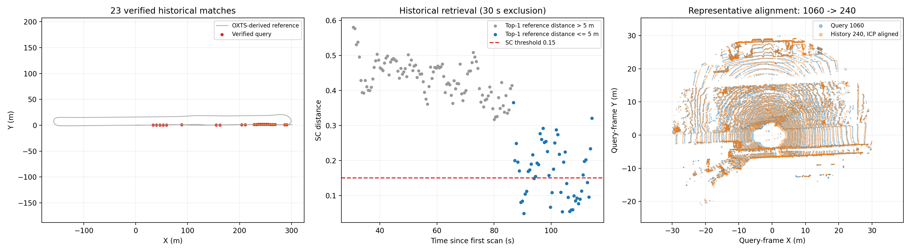
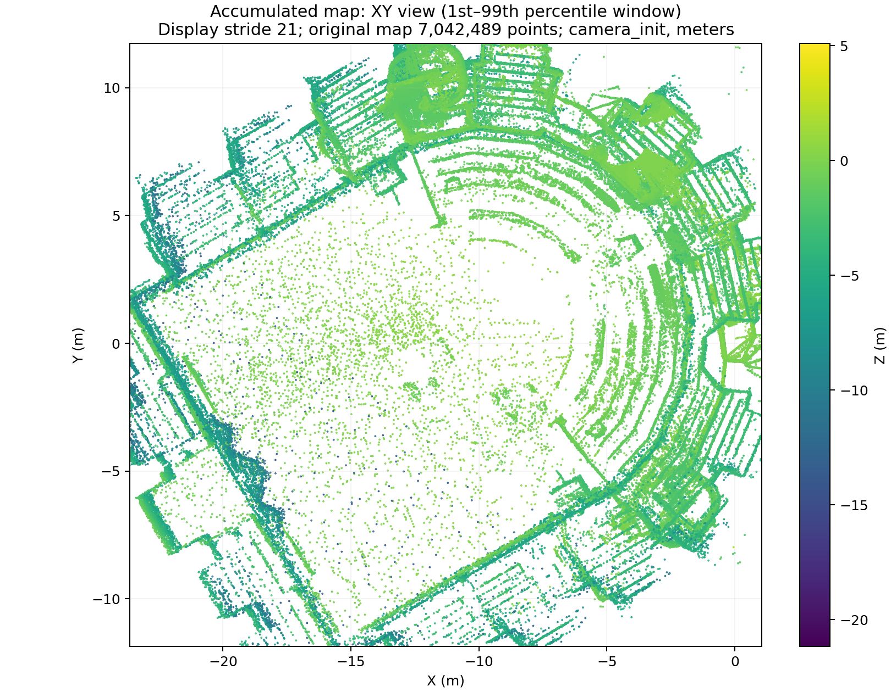
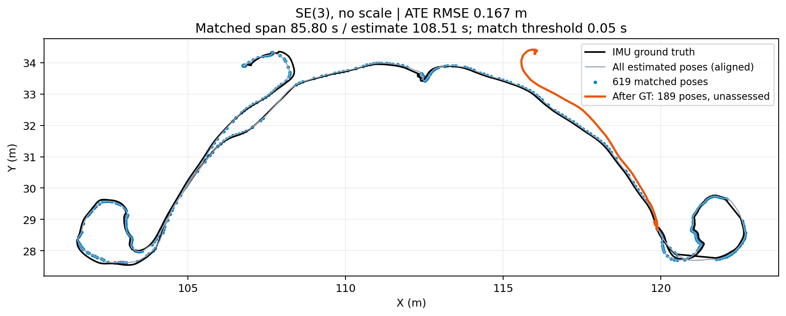

# 尹安伟 · FAST-LIO 建图、先验地图定位与地点识别

## 第二周成果（2026-10-14）

已归档 [第二周实验与演示](week2_yin_anwei/README.md)、[周报](week2_yin_anwei/WEEK2_REPORT.md) 和 [复现说明](week2_yin_anwei/REPRODUCE.md)。Hilti 同一组 763 个匹配样本独立 SE(3) 对齐后，FAST-LIO 前端 ATE RMSE 为 **0.154003 m**，地图定位输出为 **0.353149 m**：本次精度未改善，保留失败结果。

KITTI raw `2011_09_30_drive_0020_sync` 的 162 个历史查询中，23 个候选通过 SC 阈值，并全部通过 ICP 几何筛选；相对插值 OXTS 参考的平移误差中位数为 **0.051629 m**，旋转误差中位数为 **0.119786°**。这是同序列离线检索与配准，非 23 个独立回环、轨迹 ATE、跨 session 验证或在线闭环系统。

## 第一周建图与评估

Hilti 2022 `exp18_corridor_lower_gallery_2` 的 ROS2 FAST-LIO 半速基线。已交付累计 PCD、同次运行 TUM/KITTI 轨迹、evo 评估、源码补丁和复现工具。

**2026-10-08 基线：平移 ATE RMSE 0.167 m，仅针对成功匹配的 619 对位姿。** 估计轨迹共 876 个位姿、跨度 108.51 秒；匹配区间跨度 85.80 秒。末尾约 22.70 秒超出所用官方真值范围，未纳入精度评估。使用 SE(3) 对齐，无尺度校正，时间匹配阈值 0.05 秒。

| 项目 | 基线结果 |
|---|---:|
| 估计位姿 / 时间跨度 | 876 / 108.5084 s |
| 成功匹配位姿对 / 匹配时间跨度 | 619 / 85.7995 s |
| 平移 ATE RMSE / 最大误差 | 0.167018 m / 0.433353 m |
| 真值结束后的估计位姿 / 尾段时长 | 189 / 22.6993 s |
| 播放倍率 | 0.5 倍，单次播放 |
| 累计地图点数 / 文件大小 | 7,042,489 / 225,359,901 bytes |

这些指标衡量匹配位姿的平移误差，不代表整段轨迹或全部地图点的精度。地图保留了零散远距离点。

**2026-10-11 接收完整性改进：** 计数发现 BEST_EFFORT 半速实验有数百帧点云未进入回调，单纯加大队列未解决。显式使用 RELIABLE 点云订阅、点云/IMU 深度 100/20,000 后，两次独立半速回放均收到全部 1,094 帧点云和 43,656 条 IMU，得到 1,090 位姿、786 对匹配，ATE RMSE **0.196888 m**；两次轨迹和地图 SHA256 相同。推荐新复现流程使用此设置。结果与适用条件见 [运行对照](validation/20261011_qos/) 和 [诊断步骤](RUNTIME_DIAGNOSTICS.md)。

历史 0.167 m 与新结果匹配样本不同，不应直接作逐帧精度排名。2026-10-10 的 482 位姿、0.845612 m 较差复跑及本次失败控制组仍完整保留。可靠组末尾有 1 帧已接收但未处理，且真值外尾段未评估；不能称为所有输入均已处理或跨机器稳定性保证。详见 [VALIDATION.md](VALIDATION.md)。

原速可靠订阅对照得到 ATE 0.236368 m，点云完整，但 IMU 仍少 20 条；原速稳定性尚不能宣告完成。

图中仅为显示裁切至 XY 的 1%–99% 分位范围并抽样，原始 PCD 未被裁切。局部结构见[细节图](week1_yin_anwei/figures/map_detail.png)；显示参数见[render_info.json](week1_yin_anwei/figures/render_info.json)。

## 获取与复现

- [完整地图下载与 SHA256](MAP_FILE.md)：GitHub Release 附件，约 215 MiB。
- [从原始数据到评估的流程](REPRODUCE.md)：源码版本、补丁、编译、bag 转换、自动运行、轨迹转换、评估和检查。
- [实测验证记录](VALIDATION.md)：记录本次实际验证范围和新运行结果，区分历史基线与复跑。
- [运行计数与 QoS 诊断](RUNTIME_DIAGNOSTICS.md)：补丁、控制变量回放及源输入/回调/处理/输出对账。
- [文件逐项说明](week1_yin_anwei/README.md)、[第一周周报](week1_yin_anwei/第一周周报.md)、[修复记录](week1_yin_anwei/修复记录.md)。
- [来源、固定版本与许可](SOURCES.md)、[第二周任务与验收](WEEK2_PLAN.md)。

## 结果与工具

基线数据均在 `week1_yin_anwei/`。地图对应轨迹为 `trajectory_tum.txt`；`trajectory_kitti.txt` 为未对齐的同一轨迹的 3×4 `[R|t]`，`trajectory_times.txt` 为对应时间戳。数值报告见 [evaluation_scope.json](week1_yin_anwei/evaluation_scope.json)。

`tools/` 提供 bag 转换、自动采集、TUM→KITTI、evo 包装、评估范围统计、PCD/轨迹一致性检查及真实点云绘图。每次运行使用新的目录保存配置、日志、地图和轨迹。脚本拒绝覆盖已有运行目录。

补丁仅适配本次 Hilti Hesai 点云：要求 FLOAT64 绝对秒 `timestamp`、与 header 同一时间轴、UINT16 `ring`。直接修改了 Velodyne 分支；更换雷达前必须重新检查字段和时间定义。
