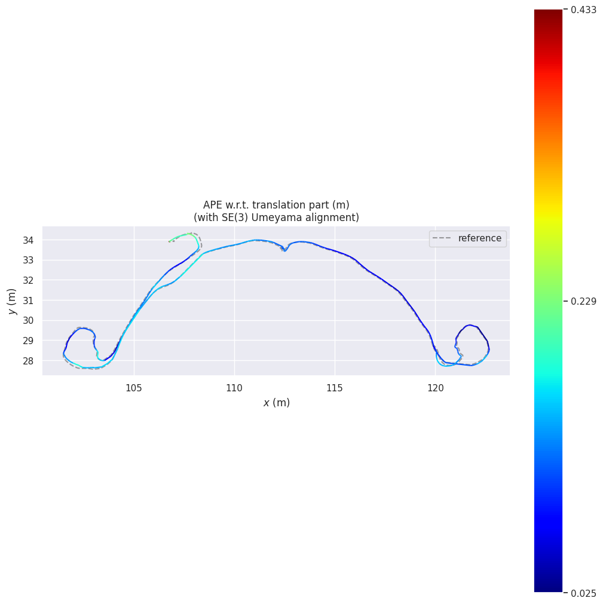

# 尹安伟 · 点云 / SLAM 第一周记录

Hilti `exp18_corridor_lower_gallery_2` 的 ROS2 FAST-LIO 建图与轨迹评估基线。

已完成：环境配置、FAST-LIO 编译、Hesai 点云适配、PCD 保存、TUM/KITTI 轨迹导出，以及 evo ATE 评估。此次使用 **0.5 倍速**播放；对匹配的轨迹位姿做 SE(3) 对齐，平移 ATE RMSE 为 **0.167018 m**。结果未做尺度校正；原速运行仍不稳定。

## 交付材料

- [完整交付说明及复现命令](week1_yin_anwei/README.md)
- [第一周周报](week1_yin_anwei/第一周周报.md)
- [修复与验证记录](week1_yin_anwei/修复记录.md)
- [KITTI 轨迹](week1_yin_anwei/trajectory_kitti.txt)、[对应时间戳](week1_yin_anwei/trajectory_times.txt)、[TUM 轨迹](week1_yin_anwei/trajectory_tum.txt)
- [ATE 结果](week1_yin_anwei/ate_results.zip)、[误差曲线](week1_yin_anwei/ate_error.png)
- [Hesai 配置](week1_yin_anwei/hesai.yaml)、[源码补丁](week1_yin_anwei/fastlio_changes.patch)
- [地图文件信息](MAP_FILE.md)、[数据与代码来源](SOURCES.md)

## 地图文件

完整地图为 `fastlio_hilti_fixed_20261008.pcd`，约 215 MiB、7,042,489 点；目前在学生本机 `D:\chromeDownload\`，本仓库保存截图和文件校验信息。需要共享完整地图时，应另提供下载地址或使用组内大文件存储约定。

第一周流程已跑通。此基线还有零散远距离点和轨迹误差，不能视为高精度地图已完成验收。
