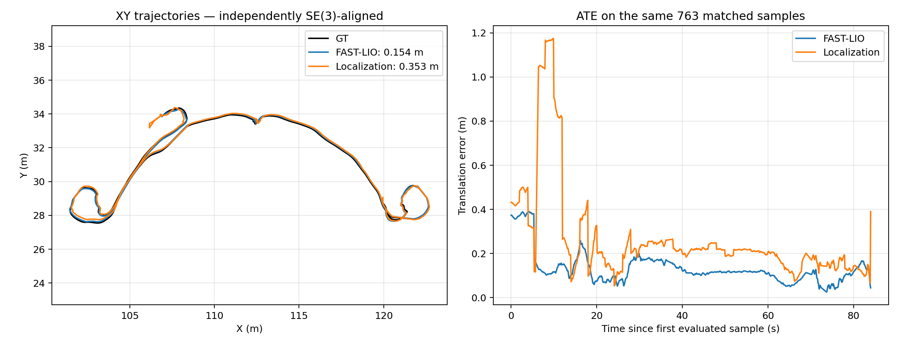

# 第二周：先验地图定位与 Scan Context 地点识别

目标：建立使用已有地图定位、检索历史地点和量化结果的实验基础，为第三周地图噪声/删块实验提供基线。两条实验分别运行，尚未串成自动恢复定位系统。

## NCLT 跨日期检索与配准（2026-10-16 新增）

主数据集按学生三要求使用 **NCLT + Hilti**，KITTI 保留为补充实验。NCLT 已完成 2012-01-08 建库、2012-02-05 查询的离线基线：1296帧历史库、1306次查询，366个候选通过SC阈值，355个通过ICP几何筛选。其中347个参考位置在5米内，8个较远；不能将355/366称为定位成功率，也不能把347个附近候选全算为正确位姿。

完整参数、误差统计、失败案例及验证范围见 [NCLT 报告](nclt/README.md)。[原始证据](nclt/evidence/) 保留全部候选，另附 [复现说明](nclt/REPRODUCE.md)、[数据来源](nclt/SOURCES.md) 和 [核验结果](nclt/VALIDATION.json)。退化拒绝规则仅做事后诊断，尚未证明泛化改善。

## Hilti 先验地图定位

运行 `event_20261013_132410`：FAST-LIO → 相同时间戳点云/里程计配对 → ICP 地图匹配 → 事件触发位姿融合。保留点云/IMU 输入队列 100/20000、RELIABLE、0.5 倍回放、模拟时间设置。

| 输出 | ATE RMSE (m) | mean (m) | max (m) |
|---|---:|---:|---:|
| FAST-LIO 前端 | 0.154003 | 0.133417 | 0.390878 |
| 地图定位 | 0.353149 | 0.268579 | 1.175103 |

**地图定位本次未提升精度。** 同一组 763 个匹配位姿、83.998773 秒；两条轨迹分别 SE(3) 对齐，无尺度修正，时间匹配阈值 0.05 秒。共有 227 个共同估计样本位于 GT 结束后，不纳入 ATE。不能视为固定地图坐标系绝对误差，也不应直接与第一周不同样本的 ATE 排名。

定位输出 1068 帧，前端 1091 帧；定位启动前有 23 个前端位姿，定位有效跨度内未发现缺少对应时间戳的前端位姿；最大相邻定位间隔 0.125582 秒。

- [评估原始报告](artifacts/runs/event_20261013_132410/evaluation_common_v1/report.json)
- [逐样本误差](artifacts/runs/event_20261013_132410/evaluation_common_v1/errors.csv)
- [导出轨迹与覆盖报告](artifacts/runs/event_20261013_132410/trajectory_export/)
- [定位配置](artifacts/config/hesai_localization_frontend.yaml)、[同步定位器](artifacts/global_localization_synced.py)、[事件融合器](artifacts/transform_fusion_event.py)

## KITTI 离线检索与几何验证

使用 raw `2011_09_30_drive_0020_sync`（1104 帧），不是直接使用 Odometry benchmark 的裁剪文件。按 OXTS 时间范围排除帧 0、1，再固定每 5 帧抽取，共 220 帧。参考位姿经 IMU→Velodyne 外参转换，再以线性平移和 SLERP 插值到扫描时间。参考位置只用于事后评估，不参与 SC 排序或 ICP 初值。

描述子 20×60，水平距离 1–80 m，沿用上游 +2 m 高度偏移；排除最近 30 秒；ring key 前 10 候选；SC 距离 <0.15。

| 项目 | 数量 |
|---|---:|
| 有历史数据的查询 | 162 |
| 参考 5 m 范围内有历史帧 | 54 |
| 第一名参考位置在 5 m 内 | 54 |
| 通过 SC 阈值 | 23 |
| 通过阈值但参考位置超过 5 m | 0 |
| ICP 几何筛选通过 | 23 / 23 |

“位置在 5 m 内”是诊断标准，不是独立标注的回环真值。其余 31 个附近查询未通过 SC 阈值，不能声称全部召回。23 对来自同一段重复经过区域，不等于 23 个独立回环事件。

ICP 初值仅用 SC yaw、零平移；体素/对应距离依次 1/3、0.5/1.5、0.3/0.5 m，每级最多 60 次迭代。双向重叠均 ≥0.5 且内点 RMSE 均 ≤0.3 m 才通过。平移参考误差中位数/最大值 0.051629/0.112613 m，旋转参考误差 0.119786/0.184076°；这些不是轨迹 ATE。

- [检索报告](artifacts/scancontext/runs/kitti0020_retrieval_v1/report.json)、[全部查询](artifacts/scancontext/runs/kitti0020_retrieval_v1/queries.csv)、[全部候选](artifacts/scancontext/runs/kitti0020_retrieval_v1/candidates.csv)
- [ICP 报告](artifacts/scancontext/runs/kitti0020_geometry_v1/report.json)、[23 对逐项结果](artifacts/scancontext/runs/kitti0020_geometry_v1/results.csv)、[相对变换](artifacts/scancontext/runs/kitti0020_geometry_v1/transforms.npz)

## 失败对照与归档范围

Hilti 的 SC 80 m、25 m、全部历史候选检索及几何失败诊断均保留在 [失败基线](artifacts/scancontext/runs/raw_20261013_193630/keyframes_v1/)。在当时位姿参考、候选与阈值下没有足够重叠，不能推广为 Hilti 数据集整体不适用。

来源于本机 `deliverables/week2_20261014_145509`，原始 [manifest.json](manifest.json) 保留源归档哈希。公开包不复制两个 PyICP-SLAM 模块正文，改为提供上游地址与 [最小补丁](upstream/scancontext_zero_overlap.patch)；manifest 中对应两个文件仅用于核对用户自行下载的源码。其他原始证据保持原字节。

不上传原始 bag、KITTI/NCLT 原始点云、PCD/PLY。已交付静态图文演示，并新增上述 NCLT 单个日期组合的离线跨 session 验证；尚无演示视频、在线定位恢复联动或闭环优化。

详见 [第二周周报](WEEK2_REPORT.md)、[复现与验证](REPRODUCE.md)、[来源](SOURCES.md)。
