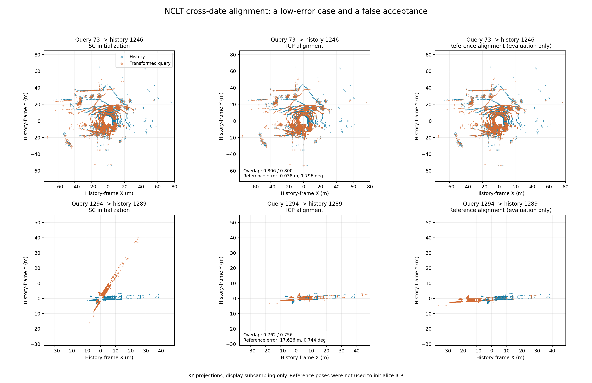

# 学生三：NCLT 跨日期地点检索与点云配准基线

2026-10-16，尹安伟。主数据集工作为 **Hilti + NCLT**：Hilti 评价连续地图定位的轨迹 ATE，本文评价 NCLT 离线跨日期检索与帧间配准。KITTI 保留为补充流程验证。这些实验尚未接入在线重定位或闭环优化。

## 实验设置

| 项目 | 设置 |
|---|---|
| 历史数据库 / 查询日期 | 2012-01-08 / 2012-02-05 |
| 提取同步点云 | 28,127 / 28,239 帧 |
| 实际描述子帧数 | 1,296 / 1,306 |
| 帧选取 | 官方协方差文件中的 SLAM 图节点时间戳，最近原始 GT 记录差 ≤20 ms，不外推、不跨无效位姿；保留有同时间戳点云的节点 |
| 坐标 | velodyne_sync 已在机体前/右/下坐标系；旋转 diag(1,-1,-1) 转为前/左/上，不重复施加雷达外参 |
| 点云筛选 | 1 < 水平距离 < 80 m |
| 描述子 | 20 环 × 60 扇区，高度偏移 +2 m；沿用上游每格最多前 500 点 |
| 粗筛 / 接受 | ring key 欧氏距离前 10；完整 SC 距离 <0.15 |
| ICP 初始化 | SC 给出的航向，零平移；查询坐标变换到历史坐标 |
| ICP 各级体素 / 对应距离 | 1/3、0.5/1.5、0.3/0.5 m，point-to-point，每级最多 60 次迭代 |
| 几何筛选 | 最终体素 0.3 m、对应距离 0.5 m；双向重叠均 ≥0.5、内点 RMSE 均 ≤0.3 m，且对应点非空 |
| 参考邻近标准 | 两帧参考位置三维距离 ≤5 m |

不同日期之间检索，不套用 KITTI 同序列实验的 30 秒历史排除规则。参考位姿用于帧清单核验及事后评价，位置不参与候选排序、SC 接受或 ICP 初始化。官方参考轨迹含 SLAM 估计和里程计插值误差，不是无误差真值；这是基于参考图节点抽样的离线实验。

## 检索与几何筛选结果

| 指标 | 数量 |
|---|---:|
| 历史数据库帧数 | 1,296 |
| 总查询数 | 1,306 |
| 存在参考 5 m 内历史帧的查询 | 1,152 |
| 不存在参考 5 m 内历史帧的查询 | 154 |
| 附近历史帧进入粗筛前 10 | 1,108 |
| SC 第一名参考位置在 5 m 内 | 1,079 |
| SC 接受候选 | 366 |
| SC 接受且参考位置附近 / 较远 | 347 / 19 |
| ICP 几何筛选通过 / 拒绝 | 355 / 11 |
| 几何通过且参考位置附近 / 较远 | 347 / 8 |

**355/366 = 97.0% 是 SC 已接受候选的几何筛选通过比例，不是重定位成功率。** 347/355 = 97.7% 仅表示几何通过候选中参考位置附近的比例。347/1152 = 30.1% 表示有附近历史帧的查询中，最终保留附近匹配的比例，仍不是精确位姿成功率。位置附近不等于配准准确。

154 个没有附近历史帧的查询中，SC 拒绝 153 个、接受 1 个。最终 8 个位置较远但几何通过的候选，还具有明显的配准参考误差，均作为误接受案例保留。

- [检索统计](evidence/retrieval_cross_date_v1/report.json)、[全部查询明细](evidence/retrieval_cross_date_v1/results.csv)、[不含参考位置的检索输出](evidence/retrieval_cross_date_v1/retrieval_only.json)
- [几何统计](evidence/geometry_cross_date_v1/report.json)、[全部366对明细](evidence/geometry_cross_date_v1/results.csv)、[变换矩阵及误差](evidence/geometry_cross_date_v1/results.json)

## 配准参考误差

以下覆盖全部 **355 个几何通过候选**，包括严重错误，单位分别为米和度。这是帧间相对变换误差，**不是轨迹 ATE**。

| 参考误差 | 中位数 | P95 | 最大值 |
|---|---:|---:|---:|
| 平移（m） | 0.066682 | 0.280538 | 52.545286 |
| 旋转（°） | 0.637553 | 2.124495 | 179.935788 |

347 个参考位置附近的通过候选中，最大平移误差仍为 2.967190 m，最大旋转误差为 12.291790°。不能把这 347 个全部标记为精确定位成功。上述两个最大值不一定来自同一候选。

## 对照案例

| 查询 → 历史 | 双向重叠 | 平移参考误差 | 旋转参考误差 | 说明 |
|---|---|---:|---:|---|
| 73 → 1246 | 0.806 / 0.800 | 0.038 m | 1.796° | 较低误差对照，初始方向已较接近 |
| 1294 → 1289 | 0.762 / 0.756 | 17.626 m | 0.744° | 几何筛选误接受 |

三列分别为 SC 初始化、ICP 配准结果、参考位姿对齐。右列仅为事后评价。图为 XY 投影，每帧最多显示 8,000 个点；同一行使用相同坐标范围。案例为事后选取的说明性样本，不能代替总体统计。细长结构提示沿延伸方向的约束可能不足，但未凭二维图证明三维退化原因。

## SC 评分退化：事后诊断

检查每个已接受候选在 SC 最佳循环移列下的共同有效扇区。如果所有共同有效扇区都仅在同一单环非零，则标记为退化。其余扇区不参与当前上游余弦评分，可能得到零 SC 距离，但不意味着原始点云相同。

366 个候选中有 8 个被标记，其中 5 个通过原始几何筛选。假设事后拒绝标记者：

| 指标 | 原始结果 | 事后假设 |
|---|---:|---:|
| 几何通过并保留 | 355 | 350 |
| 其中参考位置附近 | 347 | 344 |
| 其中参考位置较远 | 8 | 6 |

该规则会排除两个明显错误候选，也删除三个参考位置附近的候选，其中 1293 → 1284 的平移/旋转参考误差为约 0.081 m/1.000°。另外两个被删近邻候选误差较大，不能把这三对统称为正确配准。该诊断不能解释全部误接受，未修改原始基线，也未经独立日期对验证，不能宣称为已验证的改进方法。

[诊断统计](evidence/degeneracy_audit_v1/report.json) / [逐候选明细](evidence/degeneracy_audit_v1/details.csv)。

## 归档与限制

原始实验文件按目录原字节保留于 `evidence/`，由 [manifest.json](manifest.json) 记录哈希。没有将原来的退化报告改名冒充总报告。上游源码、原始激光点云和完整参考 CSV 不上传，来源及许可见 [SOURCES.md](SOURCES.md)。

执行方式及本地路径限制见 [REPRODUCE.md](REPRODUCE.md)。[verify_archive.py](verify_archive.py) 可检查归档哈希并重新汇总明细、复算参考变换误差；验证结果见 [VALIDATION.json](VALIDATION.json)。归档校验不等于重跑 ICP，也不是跨机器可复现保证。

本实验只覆盖一个日期对。已完成离线跨日期检索与配准基线及失败诊断，尚未完成在线定位恢复、轨迹闭环优化或长期多日期系统验证。下一阶段保留基线，研究地图破坏的影响；调整算法或阈值时另开版本，并使用独立数据验证。
