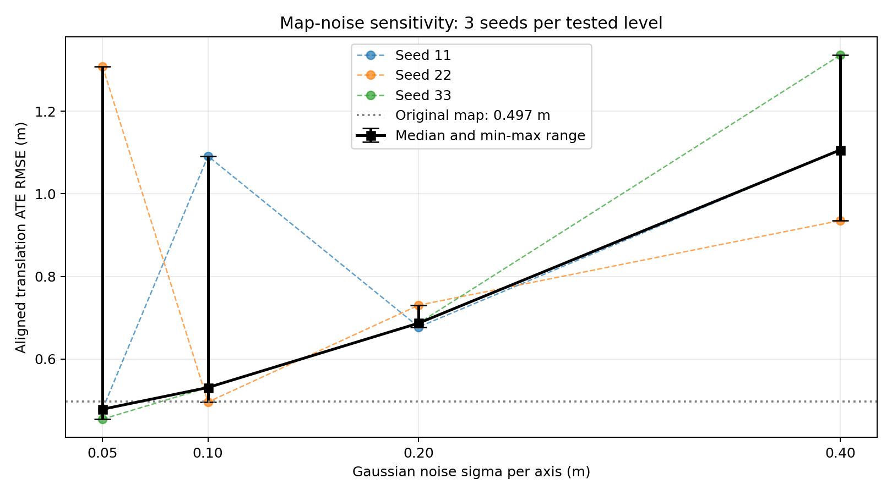
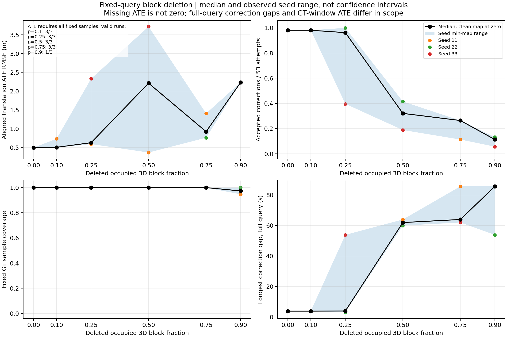

# 学生三 · 第三周：旧地图破坏对定位的影响

本目录对应尹安伟第三周当前汇报的 **28组Hilti固定查询实验**：原图1组、加噪12组、随机空间删块15组。实验记录日期为2026-10-20，原实验归档于2026-10-21；本次发布整理于2026-10-26。

## 先看什么

- [实验周报：方法、结果与局限](experiment_20261020/report/WEEK3_REPORT.md)
- [当前汇报PPT](presentation/第三周汇报_老师问题补答与结果调整版.pptx)
- [逐页讲解与答辩稿](presentation/第三周汇报_当前版逐页讲解与答辩稿.md)
- [后续讲解补充：初始化、在线/离线与配准](presentation/EXPLANATION_NOTES_20261026.md)
- [复现入口与文件说明](REPRODUCE.md)
- [发布校验记录](PUBLISH_CHECKS.json)与[逐文件SHA256](FILE_SHA256.json)

当前PPT为10月26日的文件，讲解稿为10月24日创建的版本。后续文字与页序如有调整，以PPT实际内容为准；讲解稿保留其原始版本，不把不同日期的材料说成完全同步。

## 固定输入与评价口径

| 项目 | 本轮设置 |
|---|---:|
| 固定前端里程计 | 1091条 |
| 固定扫描配准尝试 | 每组53次 |
| 固定位置评价样本 | 753对，约83秒 |
| 修正间隔统计范围 | 完整109.008数据秒，含首次接受前及末次接受后 |
| 原图融合轨迹 | 1059条位姿 |
| 原图平移ATE RMSE | 0.497221米 |
| 原图接受修正次数 | 52/53 |

每条轨迹分别做无尺度SE(3)刚体对齐，评价平移位置误差。统一采用本轮固定查询原图基线；不混用上周763样本的0.353149米，或早期在线记录的0.498909米。

所有组使用同一份扫描、里程计、查询安排、定位代码、参数和单位矩阵初值，只改变供匹配的旧地图。算法实现沿用冻结版本，没有修改ICP来迎合曲线。固定离线调度不等同于复现ROS2在线节点的完整时序。

## 地图加噪

原图XYZ的各轴独立加入零均值高斯噪声，sigma为每轴标准差；各档使用随机种子11、22、33。

| 每轴sigma（米） | ATE RMSE中位数（米） | 最小—最大（米） |
|---:|---:|---:|
| 0.05 | 0.478565 | 0.454640—1.308341 |
| 0.10 | 0.531164 | 0.496009—1.091418 |
| 0.20 | 0.687034 | 0.677690—0.730477 |
| 0.40 | 1.106390 | 0.935387—1.335830 |

测试档位的中位数随sigma增大上升，但单个种子不单调。最小—最大范围不是置信区间。

## 随机空间删块

使用边长3米、原点固定的立方网格，从有点空间块中随机删除指定比例。删块比例不等于删点比例。各档使用种子11、22、33。

| 删除有点块比例 | ATE退化 / 可评价组 | 修正中断 / 全部组 | 覆盖不足 / 全部组 |
|---:|---:|---:|---:|
| 10% | 0/3 | 0/3 | 0/3 |
| 25% | 1/3 | 1/3 | 0/3 |
| 50% | 2/3 | 3/3 | 0/3 |
| 75% | 1/3 | 3/3 | 0/3 |
| 90% | 1/1 | 3/3 | 2/3 |

本轮**事后工作判据**：ATE严格超过两倍原图基线标为轨迹误差退化；最长无新接受修正间隔严格超过10数据秒标为地图约束中断；未覆盖全部753个固定时刻则主ATE留空。阈值不是官方标准或预先登记的通用失效线。90%档位只有一个完整ATE，另外两组误差未知，不能计为未退化。

关键反例：删50%、seed11的ATE为0.368201米，低于原图，但只接受17/53次修正，最长63.982秒没有新接受修正。低ATE或持续位姿输出，均不能单独证明地图持续提供正确纠偏。

## 原始证据与目录

| 入口 | 内容 |
|---|---|
| [加噪汇总CSV](experiment_20261020/fixed_runs/noise_summary.csv) | 原图及12组加噪指标 |
| [删块汇总CSV](experiment_20261020/delete_runs/deletion_summary.csv) | 15组删块的覆盖、误差与间隔 |
| [删块事后分类](experiment_20261020/delete_runs/deletion_classified.csv) | 三个独立工作标记 |
| [固定查询缓存](experiment_20261020/fixed_query_v1) | 53帧扫描、1091条里程计及安排 |
| [配准、融合与评价脚本](experiment_20261020/tools) | 输入提取、地图变体生成、固定匹配、融合、评价 |
| [实验配置与冻结脚本](experiment_20261020/runs) | 本轮定位配置、原图哈希、脚本快照 |
| [原归档核验记录](experiment_20261020/validation.json) | 28组的时间、修正、覆盖与误差一致性检查 |
| [来源与许可](experiment_20261020/SOURCES.md) | Hilti、上游代码、原PCD来源与许可 |

逐组子目录含`attempts.csv`（全部尝试）、`corrections.npz`（接受修正）、`trajectory_tum.txt`（融合轨迹）和误差/评价文件。原始传感器bag、查询录制数据库、完整PCD及全部破坏PCD不重复提交；取得原PCD后可按生成脚本重建地图变体。

## 结论范围

本轮只测试同源Hilti地图与一条固定查询，没有新增NCLT地图破坏实验，也未完成任意起点全局初始化、在线自动恢复、长期旧图更新或Nav2导航闭环。不能把25%或50%直接宣布为普适精确临界值。

`experiment_20261020/`保留10月21日原归档字节与原SHA256，其中“未推送GitHub”等文字描述当时归档状态；当前目录的发布状态以本入口及Git记录为准。本目录不包含本机另一份46组旧草稿的数值，避免不同输入和774样本口径与本轮753样本混用。
