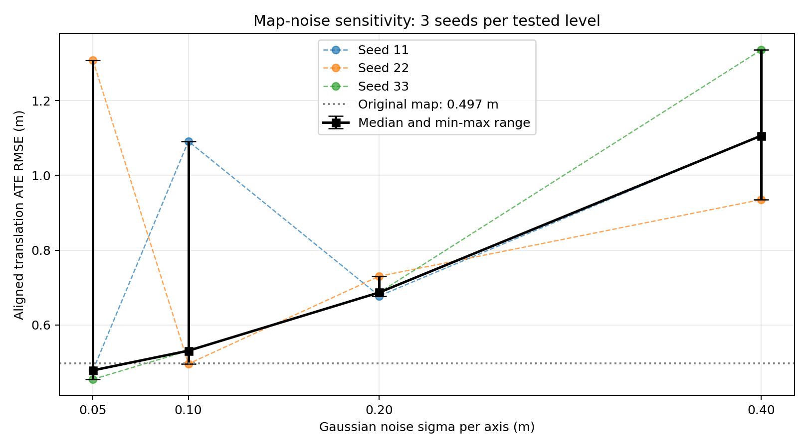
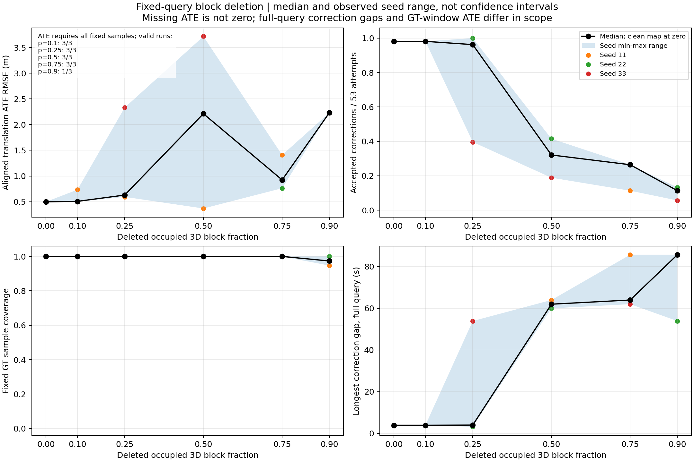

# 第三周周报：先验地图破坏对定位的影响

## 一、研究问题

在固定查询数据、定位算法、参数和初值的条件下，先验地图受到坐标噪声或空间结构删除后，轨迹误差和地图约束持续性如何变化？

## 二、实验方法

使用Hilti已有地图与查询录制，进行同源地图破坏对照。查询数据来自第二周定位流程的再次运行；地图与查询并非独立跨日期采集。

固定53个地图匹配时刻，使用冻结的地图匹配代码。首次匹配采用单位修正；未成功时按固定时刻重试，成功后沿用最近一次接受的修正作为后续初值。

地图匹配采用0.5米基础体素、两级ICP，fitness严格大于0.9时接受。将接受的修正与同次录制的里程计组合，输出定位轨迹。

加噪实验：对原图XYZ逐点加入独立高斯噪声，每轴标准差为0.05、0.1、0.2、0.4米，各使用种子11、22、33。

删块实验：采用原点固定的3米立方网格，删除10%、25%、50%、75%、90%的有点空间块，各使用种子11、22、33。删块比例与实际删点比例分别记录。

共完成28组固定查询对照：原图1组、加噪12组、删块15组。各组均从原地图生成，未叠加噪声与删块。

## 三、评价范围与判据

ATE使用同一批753对关联样本，覆盖约83秒；每条轨迹独立进行无尺度SE(3)对齐。真值范围外尾段不评价。

最长地图修正间隔统计完整109.008秒前端查询范围，包含首尾等待，因此与ATE时间范围不同。

事后工作判据：
- ATE RMSE严格超过原图基线的两倍，标记轨迹误差退化。
- 最长地图修正间隔严格超过10数据秒，标记地图约束中断。
- 未覆盖全部753个固定评价时刻，标记覆盖不足，主ATE留空。

上述判据用于本轮事后分析，不是官方标准或实验前预先确定的阈值。

## 四、实验结果

### 4.1 原图基线

固定查询流程下，原图接受52/53次地图修正，输出1059条定位位姿。共同评价样本为753对，ATE RMSE为0.497221米。

本节统一使用该固定查询基线，不混用此前在线运行的0.498909米结果。

### 4.2 地图加噪

每个噪声档位使用三个随机种子。下表统计的是各次运行ATE RMSE的中位数和最小—最大范围，单位为米。

| 每轴噪声标准差σ | ATE中位数 | 最小—最大 |
|---|---:|---:|
| 0.05米 | 0.478565 | 0.454640—1.308341 |
| 0.10米 | 0.531164 | 0.496009—1.091418 |
| 0.20米 | 0.687034 | 0.677690—0.730477 |
| 0.40米 | 1.106390 | 0.935387—1.335830 |

在测试档位中，ATE中位数随噪声标准差增大而上升，但单个种子的结果并不单调。0.4米档位的三个结果均高于原图基线，中位数约为基线的2.23倍。

0.05米和0.1米档位均出现一个误差较大的种子，说明仅展示中位数会掩盖随机地图之间的差异。最小—最大范围不是置信区间。

### 4.3 随机空间删块

15组删块实验中，13组覆盖全部753个评价时刻，2组覆盖不足，执行错误为0组。

依据本轮事后工作判据，分类如下：

| 删除有点空间块的比例 | ATE退化/可评价组数 | 地图约束中断/组数 | 覆盖不足/组数 |
|---|---:|---:|---:|
| 10% | 0/3 | 0/3 | 0/3 |
| 25% | 1/3 | 1/3 | 0/3 |
| 50% | 2/3 | 3/3 | 0/3 |
| 75% | 1/3 | 3/3 | 0/3 |
| 90% | 1/1 | 3/3 | 2/3 |

90%档位只有一个种子可以完整评价，该种子触发ATE退化；另外两个种子的完整样本ATE未知，不能计为未退化。

25%删块时，已有一个种子出现约54秒的地图修正间隔；50%删块时，三个种子的最长间隔均约60—64秒。50%及以上的测试档位中，所有种子都触发了地图约束中断判据。

因此，本轮观察到25%删块已出现部分种子的地图约束中断，50%及以上所有测试种子均出现中断。这不是精确的连续临界值，25%与50%之间尚未测试。

删块比例不等于删点比例。例如25%、种子11删除276/1106个有点块，实际删除约30.93%的地图点。

## 五、结果解释与局限

### 5.1 低ATE不等于地图约束正常

删除50%空间块、种子11时，ATE RMSE为0.368201米，低于原图的0.497221米，但仅接受17/53次地图修正，最长修正间隔为63.982秒。

代码中，匹配被拒绝后，融合流程继续使用最近一次成功修正与新的里程计组合，因此长时间没有新地图修正时，仍可能持续输出定位轨迹。

ATE又经过独立SE(3)对齐，能够吸收整体刚体偏差。因此，较低的对齐ATE不能单独证明地图匹配持续有效。上述机制有代码依据，但尚未通过独立消融确定各因素对该案例的具体贡献。

### 5.2 高fitness不等于位姿准确

fitness评价的是估计变换后，扫描点在地图中找到距离阈值内近邻的比例。它不检查真实位姿误差，也不证明最近邻来自正确的物理结构。

例如0.2米噪声、种子11接受53/53次匹配，但ATE RMSE仍为0.677690米，高于原图基线。因此匹配接受率与轨迹精度必须分别报告。

### 5.3 误差不一定随破坏程度单调增加

随机种子改变具体受扰动的地图；空间删块还会改变保留下来的结构。最近邻关系、ICP收敛结果以及历史修正形成的后续初值都可能发生变化。

这些是可能影响非单调结果的因素，目前尚未通过消融验证唯一原因。不能为了得到上升曲线而删除反常种子，也不能将局部误差降低直接解释为地图破坏改善了定位。

### 5.4 当前结论的适用范围

- 地图和查询来自同一Hilti采集序列的不同处理运行，不是独立跨日期环境验证。
- 使用固定前端录制与离线匹配调度，未重新验证完整在线系统的延迟和实时性。
- 每档仅三个种子，最小—最大范围不是置信区间。
- 噪声为累计地图上的逐点独立高斯扰动，不代表所有真实传感器或建图误差。
- 删块只测试3米块尺寸及有限比例，尚未确定精确连续临界值。
- ATE使用约83秒真值窗口，地图修正间隔使用完整109.008秒查询，二者范围不同。
- 退化和中断阈值属于本轮事后工作定义，尚未验证其跨序列适用性。
- 原图地图定位精度本身仍需改进，本周实验没有解决该问题。
- 本周未新增在线自动恢复、长期地图更新或Nav2导航闭环。

## 六、结果与复现入口

### 6.1 主要文件

以下链接相对于本报告所在目录：

| 内容 | 文件 |
|---|---|
| 加噪逐组汇总 | [noise_summary.csv](../fixed_runs/noise_summary.csv) |
| 加噪批处理状态 | [batch_noise_status.csv](../fixed_runs/batch_noise_status.csv) |
| 删块逐组汇总 | [deletion_summary.csv](../delete_runs/deletion_summary.csv) |
| 删块事后分类 | [deletion_classified.csv](../delete_runs/deletion_classified.csv) |
| 事后工作判据 | [posthoc_criteria.json](../delete_runs/posthoc_criteria.json) |
| 固定匹配时间表 | [schedule.json](../fixed_query_v1/schedule.json) |
| 固定查询原图ATE | [ate_report.json](../fixed_runs/clean_v1/ate_report.json) |
| 定位参数 | [localization.yaml](../runs/clean_20261020_155929_tQ0v/localization.yaml) |
| 评价时间范围 | [scope.json](../runs/clean_20261020_155929_tQ0v/common_eval/scope.json) |

每个固定查询运行目录保留attempts.csv、corrections.npz和冻结定位代码。有定位输出时保留trajectory_tum.txt。

加噪完整评价保存在ate_report.json；删块评价保存在deletion_report.json。删块覆盖不足时，主ATE为空，需同时读取状态与覆盖率。

### 6.2 脚本入口

脚本位于/home/yaw/fastlio_week3/tools：

- generate_noisy_map.py：生成指定噪声强度和种子的地图。
- generate_deleted_map.py：生成指定删块比例、块尺寸和种子的地图。
- run_fixed_matching.py：对固定53帧执行地图匹配。
- fuse_fixed_trajectory.py：使用不晚于当前里程计的最近成功修正生成轨迹。
- evaluate_fixed_trajectory.py：要求全部固定评价时刻完整的ATE评价。
- batch_noise.py：加噪批处理。
- batch_deletion.py：删块批处理，同时记录覆盖率及完整查询修正间隔。
- summarize_noise.py、plot_noise_levels.py：加噪汇总与绘图。
- classify_deletion.py：按事后工作判据生成删块分类表。

### 6.3 复现注意事项

实验使用WSL Ubuntu、ROS2 Humble；点云处理使用系统Python、NumPy 1.21.5和Open3D 0.14.1，评价使用既有venv-eval环境中的evo v1.37.1。

脚本保留本机绝对路径，并非跨机器一条命令安装包。其他环境需先恢复相应输入目录或统一修改路径，保存修改记录。

完整重跑需要原PCD和固定查询缓存；从原始传感器数据重新生成查询，还需要原始bag、前端源码与配置。重新运行前端产生的结果应另建基线，不默认等同于本轮缓存。

单组原始运行目录拒绝覆盖。重新实验使用新目录；汇总表、曲线及事后分类属于可重新生成的派生结果。

## 七、汇报提纲

1. 问题：旧地图受到破坏后，定位精度和地图约束持续性怎样变化？
2. 方法：固定查询、代码、参数、初值和匹配时刻，只改变旧地图；加噪与删块分开测试，每档三个种子。
3. 加噪结果：测试档位的ATE中位数随噪声增加而上升，但单个种子不单调，低噪声也可能出现较大误差。
4. 删块结果：25%时出现部分种子的地图约束中断；50%及以上所有测试种子触发中断；90%时两个种子评价覆盖不足。
5. 关键案例：删50%、种子11的ATE较低，但地图修正长时间中断。必须联合报告误差、接受率、覆盖率和修正间隔。
6. 局限：同源序列、有限种子和档位、离线固定调度、事后判据，尚未获得跨日期或跨场景的通用失效阈值。

汇报时将“观测结果”“代码机制”和“待验证解释”分开，不将匹配接受次数称为定位成功次数。
