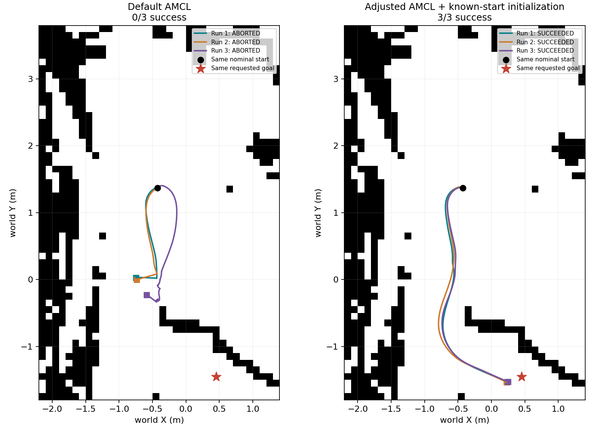

# 第四周：Hilti点云局部仿真与导航验证

把已有PCD的一小块区域转换成二维导航地图和对应Gazebo障碍，使用TurtleBot3、AMCL和Nav2执行给定目标。这里归档代码、配置、地图与世界、全部已有实验记录、汇报与讲解材料。

本周主要验证地图转换与定位、规划、控制之间的配合。未提出新导航算法，未把以前的三维重定位模块接入本次导航，也未完成第五周巡检任务。

## 优先阅读

- [当前汇报PPT（9页修改副本）](week4_presentation/第四周汇报_原理到结果版_修改副本.pptx)
- [给非专业老师的大白话逐页讲稿](week4_presentation/第四周汇报_给非专业老师的大白话讲稿.md)
- [较详细的九页讲解](week4_presentation/第四周汇报_九页通俗逐页讲解.md)
- [流程与知识梳理](week4_learning/第四周流程与知识梳理.md)
- [本次归档的复现入口](REPRODUCE.md)
- [绕障调整、全部逐轮数据与适用条件](week4_presentation/绕障改善_已知起点验证.md)

`week4_presentation`也保留较早PPT，属于历史版本；本页上面的9页修改副本为当前入口。历史说明、原始日志中的本机绝对路径按原样保留，换机器请使用本目录的复现入口，不依赖那些旧路径。历史交付说明和delivery_manifest.json只对应当时的分享包，本次文件清单见manifest.json。

## 实际做了什么

1. 原PCD共7,042,489点，裁剪X∈[-2.2,1.4)、Y∈[-1.8,3.8)米，比较高度段。
2. 使用参考高度段Z∈[-1.5,-0.8]米，筛选43,477点，以0.1米栅格统计，每格至少5点标占据。
3. 生成36列×56行地图，393个占据格。由同一栅格生成393个碰撞体和393个外观体，柱体0.1×0.1×1米，增加人工平地。
4. 运行AMCL定位、NavFn规划（Dijkstra配置）、DWB控制，先做官方演示和局部场景测试，再做固定任务重复实验。
5. 保存任务状态、墙钟耗时、恢复次数、停稳后的Gazebo位置与朝向，并保留超时、失败和启动故障。

## 当前重复实验结果

每类任务独立3轮，固定该类任务起终点，每轮新启仿真。表内距离来自Gazebo仿真实际状态，非真实硬件外部测量，不是ATE。各类任务起终点不同，不把它们合成统一成功率。

| 任务 | Action成功 | 实际位置距离≤0.25m | 实际终点距离(m)，均值[最小,最大] | 朝向误差范围(°) |
| --- | --- | --- | --- | --- |
| 短程 | 3/3 | 3/3 | 0.148 [0.143, 0.157] | 13.8–14.2 |
| 跨区域 | 3/3 | 2/3 | 0.242 [0.221, 0.273] | 14.4–14.8 |
| 绕障调整后（已知起点） | 3/3 | 3/3 | 0.226 [0.215, 0.238] | 14.1–15.9 |

短程和跨区域证据：[固定任务9轮原始记录](week4_learning/validation/repeated_20261030_194814/)。调整后的绕障证据：[3轮确认](week4_learning/validation/repeated_confirmation_20261030_231146/)。

绕障在当前近似重建起点下，调整前3轮Action成功0/3，调整后确认3/3。组合调整了6个AMCL参数、已知起点的初始不确定度和分阶段启动。地图、障碍几何、规划器与控制器未因此改动，不能把结果归因于某一个参数。调整后同时满足任务成功、实际位置≤0.25米、朝向≤0.25弧度的是1/3，不能称3/3精确停靠。

旧40.89秒绕障成功记录也保留，但旧物理起点未记录，后来是按旧定位估计近似重建，不能宣称精确重放。其他起点的超时、单柱任务、中间调参、启动失败记录均保留，不能混入当前3轮。

## 文件组织

| 目录或文件 | 内容 |
| --- | --- |
| week4_learning/*.py、*.sh、*.launch.py | 点云处理、地图导出、世界构建、启动、测量与汇总脚本 |
| week4_learning/scene_learning | 正式练习地图与世界，可直接用于仿真，无需下载PCD |
| week4_learning/candidates_v1 | 静态候选，仅做静态检查，未进行导航验证 |
| week4_learning/validation | 成功、失败、超时、探索、启动故障等原始证据 |
| week4_presentation | 当前及历史汇报PPT、实验说明、讲稿 |
| VALIDATION.json、manifest.json | 本次静态校验与逐文件SHA256 |

## 结论的范围

白格只表示选定高度段点数不足，未证明是真实安全地面。障碍柱和人工平地简化了地形，高度段仍未证明最优。地图与world一致性不等于源环境解释正确。导航使用已知起点，不能据此证明未知位置全局重定位。当前是小样本集成验证，未测量碰撞接触事件，也不证明真实环境部署安全。

原PCD沿用[第一周下载入口与哈希](../MAP_FILE.md)，不重复提交225MB文件。临时缓存、持续输出的recovery日志、音频转写、PPT制作工作目录和第五周文件不属于本次归档。
