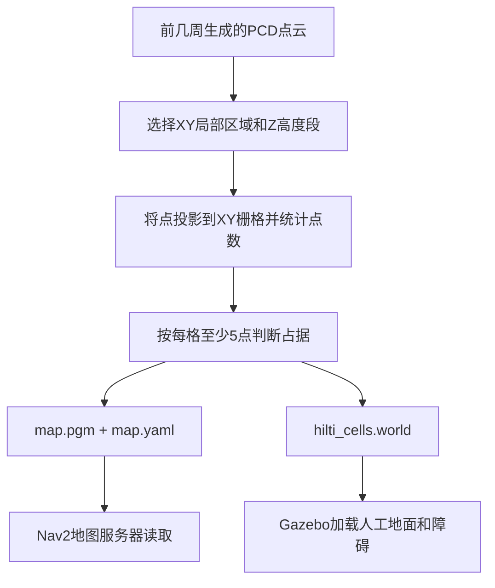
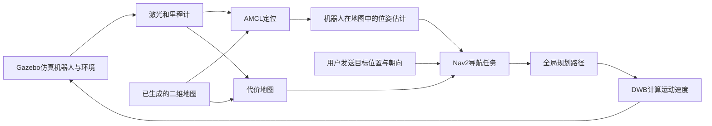
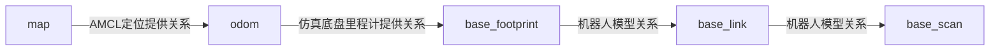

# 第四周流程与知识梳理：从 Hilti 点云到 Gazebo 仿真环境

适用对象：学生3，已经跟着操作跑通，但需要把命令背后的关系理清。

本文只整理第四周。A*切换、巡检点编排和完整闭环视频属于第五周，本文不要求继续做。文中“本次”“当前配置”指2026年10月29日这套局部练习场景的记录，不代表任何时候运行参数都自动相同。

**先记住一句话：本周是用点云的一部分信息，搭出一个简化仿真环境，再验证机器人能在其中定位、规划和运动。**

## 阅读顺序

第一次先看第1—4节，理解做了什么；第二次看第5—9节，理解程序怎么配合；需要重新操作时看第10—11节；写周报前看第12—15节。

1. 本周到底完成什么
2. 整体流程：两条链路
3. 第一步：理解PCD和高度切片
4. 第二步：从点云生成二维栅格
5. 第三步：同一份栅格生成地图和世界
6. 运行时各模块如何配合
7. 坐标、TF和仿真时间
8. 代价地图、机器人尺寸和通道宽度
9. 规划、行驶目标和“到达”有什么区别
10. 四个窗口与日常启动流程
11. 出问题时按什么顺序检查
12. 本次实验到底证明了什么
13. 文件索引和复现入口
14. 可以写进周报的总结
15. 自检问题与参考答案

## 1. 本周到底完成什么

培养方案给学生3的第四周任务是：**Nav2 + Gazebo，先跑官方TurtleBot演示，再把Hilti地图转成Gazebo世界，得到组内地图仿真环境。**

本次实际完成的内容：

| 内容 | 实际做到哪里 |
|---|---|
| 官方演示 | 跑通过TurtleBot3、Gazebo和Nav2的基本演示 |
| 点云处理 | 从自己的PCD裁剪局部区域，比较两个高度段，生成二维占据栅格 |
| 仿真世界 | 按占据格生成长方体障碍，添加人工平地 |
| 对齐检查 | 核对393个占据格与393个碰撞体、393个外观体对应 |
| 运行验证 | 有短程成功、手动目标成功、一次绕障成功，也保留了失败和超时 |
| 复现材料 | 保存脚本、配置、地图、世界、截图、日志和说明 |

这套成果应称为：**基于Hilti局部点云切片的简化仿真环境。**

它包含两个重要简化：地面是人为添加的平面；障碍物统一挤出为1米高。真实地面、楼梯、坡度、楼层和物体高度没有完整重建。导航成功是在这些假设下取得的。

## 2. 整体流程：两条链路

### 2.1 数据准备链：把地图做出来



### 2.2 运行验证链：让机器人在其中运动



**前一条链生成文件，后一条链运行程序。**文件已经生成，不代表仿真已经启动；仿真已经启动，也不代表已经收到行驶目标。

Gazebo中的激光是仿真机器人观察简化世界产生的新数据。本次没有把原始Hilti录包直接当作这辆小车的实时传感器，也没有在这里重新跑FAST-LIO建图。

## 3. 第一步：理解PCD和高度切片

### 3.1 PCD里保存的是什么

PCD是一种点云文件格式。这里每个点包含：

```text
x y z intensity normal_x normal_y normal_z curvature
```

这些是每一个点携带的字段，不是8个不同的点。PCD头部FIELDS规定读取顺序，字段实际含义还要结合生成程序。[PCD格式说明](https://pointclouds.org/documentation/tutorials/pcd_file_format.html)。

| 字段 | 通常表示什么 | 本次是否用于转换 |
|---|---|---|
| x、y、z | 点在源坐标系中的三维位置，本次单位为米 | 是，负责筛选区域、高度与计算格索引 |
| intensity | 激光回波强度，表示信号强弱，不是点的密度 | 否 |
| normal_x、normal_y、normal_z | 若已计算法向量，表示垂直于局部表面的方向在三个轴上的分量 | 否 |
| curvature | 通常用于保存局部表面变化/曲率估计，实际语义由生成代码决定 | 否 |

例如本文件第一个点约为：

```text
x=-0.254，y=-0.658，z=-0.150，intensity=17
normal_x=0，normal_y=0，normal_z=0，curvature=0
```

已对本文件全部7042489个点逐列检查：intensity范围为0—255，三个normal字段和curvature字段全部为0。不能由此认定所有表面都是平面；这份文件没有提供可用于表面朝向和曲率分析的有效相应信息。本周转换只使用x、y、z，不受这四列为0的影响。

还要避免仅凭字段名推断含义：FAST-LIO某些预处理代码会借用curvature保存点的时间信息。这说明字段存在，并不保证已经计算了几何曲率；本文件全0的具体生成原因尚未追溯。[FAST-LIO预处理代码](https://github.com/hku-mars/FAST_LIO/blob/main/src/preprocess.cpp)。

本次文件有7042489个点，采用binary存储，每个字段都是4字节浮点数，每点8个字段，所以每点32字节。转换脚本主要读取x、y、z。

PCD头部的HEIGHT=1描述点云的存储组织方式，不代表场景只有1米高。Z也只是点在源坐标系里的高度数值，不自动等于“离地面多高”。

### 3.2 为什么先裁剪一个区域

当前练习采用：

```text
X：[-2.2, 1.4) 米，跨度3.6米
Y：[-1.8, 3.8) 米，跨度5.6米
Z：[-1.5, -0.8] 米
```

局部范围便于理解坐标、检查转换结果，也减轻仿真负担。它只是整张地图的一部分。

Z筛选回答的是：“哪些高度范围的点参与二维投影？”它没有回答：“这个高度范围一定是适合机器人观察的障碍物吗？”后者还需要结合原点云、地面和场景结构判断。

### 3.3 两个高度段对比说明了什么

固定XY区域、0.1米分辨率及每格至少5点，得到：

| Z高度段 | 保留点数 | 占据格数量 | 总格数 |
|---|---:|---:|---:|
| [-1.5,-0.8]米 | 43477 | 393 | 2016 |
| [-0.3,0.3]米 | 576939 | 644 | 2016 |

同一个XY位置，在不同高度可能观察到不同结构，所以二维图会不同。点更多、黑格更多、白格更多或小车更容易走，都不能单独证明某个高度段更合理。

本次运行使用第一组，是已建立并验证过的练习基线；**尚未证明它是最合适的高度段，更没有把它认定为离地高度。**

## 4. 第二步：从点云生成二维栅格

### 4.1 一个格子表示什么

分辨率resolution=0.1米，表示每格覆盖0.1×0.1平方米。

```text
列数 = 3.6 / 0.1 = 36
行数 = 5.6 / 0.1 = 56
总格数 = 36 × 56 = 2016
```

每个被选中的点，根据XY坐标落入某个格子。对于本次地图：

```text
col = floor((x - xmin) / resolution)
row = floor((y - ymin) / resolution)
```

floor表示向下取整。比如x=-2.15，xmin=-2.2，则col=floor(0.05/0.1)=0，位于第0列。

### 4.2 黑格和白格是怎么产生的

```text
格内选中点数 >= 5：占据，导出为黑格
格内选中点数 < 5：未达到阈值，导出为白格
```

这里的5是“点数阈值”。它与map.yaml里的occupied_thresh=0.65属于不同环节，不能混为一谈。

**本次白格的原始含义只有：选定高度段内，该格的点数不足阈值。**

点数少可能来自缺失扫描、遮挡、切片没有覆盖到结构、实际空旷空间等多种情况。原点云也可能包含楼梯、落差或不同楼层。此步骤没有证明那里存在能支撑机器人的平地。

你自己的理解是：“有可能缺了，不能说明一定是地面，有可能有楼梯。”这抓住了关键。

为了做当前演示，我们把白格导出成导航地图里的自由格，并在Gazebo添加平地。这是建模假设，而非从点数不足直接测得真实可通行性。

### 4.3 为什么图片需要上下翻转

统计数组的第0行靠近最小Y；图片的第0行通常位于顶部。导出PGM时需要上下翻转，让图片与真实XY方向对应。

没有处理好行序，可能出现图像上下镜像，导致机器人观察到的障碍与导航地图对不上。

## 5. 第三步：同一份栅格生成地图和世界

### 5.1 map.pgm与map.yaml：给Nav2看的地图

PGM保存像素；YAML说明像素如何换算成地图坐标。本次YAML是：

```yaml
image: map.pgm
mode: trinary
resolution: 0.1
origin: [-2.2, -1.8, 0.0]
negate: 0
occupied_thresh: 0.65
free_thresh: 0.196
```

| 字段 | 怎样理解 |
|---|---|
| image | 实际地图图片的位置 |
| resolution | 每个像素代表多少米 |
| origin | 地图栅格原点的X、Y、偏航角；第三项不是Z高度 |
| negate | 像素明暗与占据解释是否反转；本次为0 |
| occupied_thresh/free_thresh | 导入像素时判断占据、自由的阈值 |
| trinary | 按占据、自由、未知三类解释像素 |

本次导出的像素只有0和254，分别用于占据与自由；没有在图片内部把低点数格进一步区分成“未知”。因此，支持trinary模式不等于我们已经从点云准确识别了未知空间。

### 5.2 .world：给Gazebo加载的环境

Gazebo需要地面、物体几何和碰撞信息。脚本对每个黑格生成：

```text
长：0.1米
宽：0.1米
高：1.0米
```

每个障碍同时有visual和collision：前者负责外观，后者参与物理碰撞。本次两者位置、大小一致。

世界里的地面设在仿真Z=0，障碍中心放在Z=0.5，底部正好接触地面。原点云的负Z数值只参与切片选择；它没有作为这些长方体的真实底部或顶部高度保留下来。

### 5.3 为什么格中心要加0.5

```text
障碍中心X = xmin + (col + 0.5) × resolution
障碍中心Y = ymin + (row + 0.5) × resolution
```

第0列覆盖X∈[-2.2,-2.1)，其中心是-2.15，不是-2.2。加0.5就是从格子的边界走到格子的中心。

### 5.4 为什么要同时保留地图和世界

| 文件 | 主要使用者 | 回答的问题 |
|---|---|---|
| PCD | 转换脚本、点云工具 | 原始测量点在哪里 |
| map.pgm/map.yaml | Nav2地图服务器及使用地图的模块 | 二维地图上哪些格被认为占据或自由 |
| hilti_cells.world | Gazebo | 仿真里有哪些地面、物体和碰撞体 |
| rviz_light.rviz | RViz | 哪些数据显示出来、怎样显示 |

本次PGM与world由同一份占据栅格生成，检查确认393个占据格与393个碰撞体及393个visual对应。这个检查证明转换的一致性，没有证明源高度段的物理解释正确。

## 6. 运行时各模块如何配合

### 6.1 先分清四个名字

| 名字 | 负责什么 | 在本次实验里怎样出现 |
|---|---|---|
| Gazebo | 仿真物理世界和机器人传感器 | 生成激光、里程计，接收速度让车运动 |
| ROS2 | 程序之间的通信与运行框架 | 把传感器、定位、规划和显示模块连起来 |
| Nav2 | 导航模块集合 | 组织定位相关接口、代价地图、规划、控制和任务执行 |
| RViz | 可视化及交互界面 | 显示地图、激光、机器人，设置初值或导航目标 |

在Gazebo看见小车，不代表定位就绪；在RViz看见地图，不代表小车已经知道自己在哪里。

### 6.2 本次常见节点

| 节点/模块 | 作用 |
|---|---|
| map_server | 读取map.yaml，发布二维地图 |
| robot_state_publisher | 根据机器人模型和关节信息发布机体内部坐标变换 |
| amcl | 用已有地图、激光与运动信息进行二维定位 |
| global_costmap | 融合静态地图、激光障碍和膨胀代价，供全局规划使用 |
| local_costmap | 表示机器人附近环境，供运动控制使用 |
| planner_server | 计算全局路径 |
| controller_server | 使用DWB等控制器计算跟踪路径的速度 |
| velocity_smoother | 在本次启动链中平滑速度指令 |
| bt_navigator | 组织导航任务、规划、跟踪及恢复流程 |
| lifecycle_manager | 按顺序管理相关节点的状态转换 |

AMCL是本周使用的定位模块。本次并未把第二周的FAST-LIO-LOCALIZATION或Scan Context接入这条仿真链。

### 6.3 Topic、Service、Action有什么区别

| 通信方式 | 用法 | 本次例子 |
|---|---|---|
| Topic，话题 | 发布和订阅数据 | /scan、/odom、/map、/clock |
| Service，服务 | 请求某项操作并取得响应 | /spawn_entity生成机器人模型 |
| Action，动作任务 | 提交任务，等待反馈与最终结果，并支持取消 | /navigate_to_pose导航到某个位姿 |

接口类型的概念可对照ROS2官方文档源：[Topic](https://github.com/ros2/ros2_documentation/blob/humble/source/Concepts/Basic/About-Topics.rst)、[Service](https://github.com/ros2/ros2_documentation/blob/humble/source/Concepts/Basic/About-Services.rst)、[Action](https://github.com/ros2/ros2_documentation/blob/humble/source/Concepts/Basic/About-Actions.rst)。

### 6.4 重点认识这些数据

| 名称 | 意思 | 怎样使用这个信息 |
|---|---|---|
| /clock | 仿真时间 | 检查仿真是否持续提供时间 |
| /scan | 激光距离测量 | 检查是否有发布者、有实际消息 |
| /odom | 里程计消息 | 检查机器人运动状态数据 |
| /map | 二维占据地图消息 | 确认地图服务器加载了正确地图 |
| /tf、/tf_static | 坐标变换 | 把不同坐标系下的数据联系起来 |
| /initialpose | 初始位姿估计 | 告诉定位模块一个初始位置和朝向 |
| /plan | 全局规划路径 | 看路线从哪里走到哪里 |
| /cmd_vel | 本次仿真底盘最终使用的速度话题 | 判断是否存在实际运动指令 |

话题名字出现在列表里，只说明ROS图中存在相应端点，不保证有发布者，更不保证正在接收到消息。因此，排查时要把topic list、topic info和echo结合起来看。

## 7. 坐标、TF和仿真时间

### 7.1 地图坐标与屏幕方向

X、Y是地图坐标，不是屏幕像素。当前RViz视角有旋转，因此屏幕向左不应机械解释为世界坐标-X。看图选点可以使用相对位置，精确讨论目标时应看消息中的坐标。

位姿包含位置和朝向。对于平面运动，朝向常用yaw表示；ROS消息中的orientation通常用四元数。本次yaw=π/2时，纯平面旋转对应：

```text
orientation.x = 0
orientation.y = 0
orientation.z ≈ 0.7071068
orientation.w ≈ 0.7071068
```

这里orientation.z不是高度。高度属于position.z。

### 7.2 TF解决的是什么问题

激光点相对于雷达，机器人相对于里程计，规划目标相对于地图。TF维护它们在不同时刻的坐标关系，使程序能把数据转换到同一坐标系。[TF2概念](https://github.com/ros2/ros2_documentation/blob/humble/source/Concepts/Intermediate/About-Tf2.rst)。

本次关键链路可简化为：



base_footprint是平面机体参考，base_link是机体坐标，base_scan是激光参考。中间关系应以实际机器人模型为准。

map_server发布地图消息，不等于它会自动建立map到小车的完整TF链。因而曾出现“地图能显示，但RobotModel报没有到map的变换”。

另一个细节：/odom话题与odom坐标系名字相似，但不是同一个概念。收到里程计消息后，仍应检查需要的TF是否存在、时间是否可用。

### 7.3 为什么要提供初始位姿

AMCL需要一个初始位置假设，随后根据激光与地图匹配更新估计。本次出生位置是(0.05,-0.05)，朝向π/2，因此初始化时提供同样的已知值。

**设置初始位姿是在改变定位模块的估计，不是在把Gazebo里的机器人传送到那个位置。**小车已经走远时，不能随便把初值设回出生点来“恢复正常”。

active [3]只表明AMCL处于激活状态，不保证已经收到初值或建立了map到机器人的变换。我们曾遇到命令显示发布成功，但AMCL仍要求初值；后来通过重复发布、延长发布节点存活时间及核验TF来确认真正就绪。

### 7.4 为什么大家要使用同一种时间

Gazebo通过/clock提供仿真时间。use_sim_time=True的节点使用这个时间源；仿真可以暂停、变慢或重新开始，和电脑系统时间不同。[ROS2时间设计](https://design.ros2.org/articles/clock_and_time.html)。

例如，激光记录在仿真第300秒，若另一模块按电脑系统时间查找对应变换，就可能取不到可用TF。本次启动器让RViz从启动时就使用仿真时间，而不是等报错后临时修改。

**节点存在、节点active、传感器有消息、定位就绪、时间一致，是不同检查项。**

## 8. 代价地图、机器人尺寸和通道宽度

### 8.1 为什么已经有地图，还要有代价地图

原始二维地图描述了我们导出的占据与自由格。规划还需要考虑激光发现的障碍、机器人尺寸以及与障碍保持距离的偏好，因此会构建代价地图。

本次全局代价地图启用了静态地图层、激光障碍层和膨胀层。局部代价地图关注机器人周围，并用于速度计算。它们会随传感器和机器人状态更新，不是永远等同于原始PGM。

### 8.2 我们在RViz叠加了什么

新添加的Map显示订阅的是/global_costmap/costmap，Alpha=0.4，Color Scheme=costmap。Alpha是显示透明度，不会改变导航算法里的代价。

在该配色下，0代价格透明，能够露出下面的原始地图；普通正代价使用渐变色，99使用青色，100使用紫红色。叠在黑白底图上后，实际看见的颜色也受透明度影响。[RViz配色实现](https://github.com/ros2/rviz/blob/humble/rviz_default_plugins/src/rviz_default_plugins/displays/map/palette_builder.cpp#L94-L107)。

本次看到的大片白色区域，是优先观察的低代价候选区域。颜色不是地面材质，也不能用单个像素颜色替代完整机器人碰撞检查。

### 8.3 0.22米与0.55米是两个概念

| 参数 | 本次值 | 含义 |
|---|---:|---|
| robot_radius | 0.22米 | 当前圆形机器人近似的参考半径 |
| inflation_layer.inflation_radius | 0.55米 | 障碍向外增加代价的影响范围 |

参考直径为2×0.22=0.44米。比较通道宽度时，这是一个初步几何尺度，还要考虑footprint padding、地图分辨率、定位和控制余量。

膨胀层在障碍附近给出较高代价，并让外围代价随距离衰减。不能把整个0.55米范围理解成同一种禁止区域，也不能简单把0.55米当作机器人的半径。[膨胀代价计算](https://github.com/ros-navigation/navigation2/blob/1.1.20/nav2_costmap_2d/include/nav2_costmap_2d/inflation_layer.hpp#L137-L153)。

举例：0.60米通道相对于0.44米参考直径，总共只剩0.16米；若居中，两侧各约0.08米。它有几何余量，但不保证在实际地图、定位误差和控制条件下能可靠通过。

### 8.4 你测到的0.360397米说明什么

你关闭代价地图覆盖层后，用Measure在下边缘一处缝隙两侧取点，读数约0.360397米，即36厘米。

```text
本次测线长度约0.36米 < 当前参考直径0.44米
差值约0.08米
```

在两端正确落在面向通道的障碍边界的前提下，该间隙不适合作为当前圆形模型的通道。线略斜，不能当作严格垂直的最窄宽度；不过这个数已经小于参考直径，足以用于本例的筛除判断。

它只是在判断这一处间隙，尚未证明这处缝隙就是此前绕障超时的原因。某处不能穿过，也不等于目标永远不可达，规划器可能寻找其他绕行路线。

Measure的操作是点击两个点，窗口底部显示Length，右键重置。[测距工具实现](https://github.com/ros2/rviz/blob/humble/rviz_default_plugins/src/rviz_default_plugins/tools/measure/measure_tool.cpp#L111-L136)。

## 9. 规划、行驶目标和“到达”有什么区别

### 9.1 看到绿色路径，小车为什么可以不动

本次使用过两个不同Action：

| Action | 请求做什么 | 单独调用时是否要求小车沿路径行驶 |
|---|---|---|
| /compute_path_to_pose | 计算到目标的路径 | 否 |
| /navigate_to_pose | 执行一次导航任务 | 是，需要规划和控制等模块配合 |

我们曾调用前者检查旧目标，生成了一条绿色路径，却没有发送后者，所以当时小车没有动。这是任务类型不同，不能据此认定控制器卡住。

后来实际发送导航目标，小车执行了绕障，最终返回SUCCEEDED。

### 9.2 Nav2 Goal与2D Pose Estimate

| 按钮 | 用途 | 操作的含义 |
|---|---|---|
| 2D Pose Estimate | 设置定位初值 | 告诉定位模块“我估计小车目前在这里、朝这个方向” |
| Nav2 Goal | 发送导航目标 | 告诉导航系统“请走到这里，最后朝这个方向” |

使用Nav2 Goal时，按下鼠标的位置是目标位置，拖出的箭头方向是目标朝向，释放后发出任务。

### 9.3 三个层次的检查

1. **规划成功**：计算出了路径。
2. **执行成功**：导航Action返回SUCCEEDED，相关节点记录目标完成。
3. **位置检查**：在明确坐标、时刻和数据来源后，核对实际或估计停靠位置与目标的距离。

三者应分别记录。ETA=0、距离反馈暂时不变或RViz仍显示上次的reached，都不能单独代替本次Action最终状态。

ABORTED表示任务失败；CANCELED表示任务被取消。我们的测试脚本达到时间上限后会主动取消，所以“测试超时已取消”应与“Nav2自行返回失败”区分。

### 9.4 两种目标容差为什么不同

本次读到：

```text
GridBased.tolerance = 0.5米
general_goal_checker.xy_goal_tolerance = 0.25米
```

第一项用于规划阶段：当原目标不可达时，NavFn可在目标附近的容差搜索范围内寻找可达终点。该实现按X、Y方向展开搜索范围，不宜直接称作严格的0.5米圆形半径。[NavFn实现](https://github.com/ros-navigation/navigation2/blob/1.1.20/nav2_navfn_planner/src/navfn_planner.cpp#L257-L282)。

第二项是到达检查的位置条件。控制器以收到的路径终点作为检查目标，还要检查朝向。本次stateful=True，在位置条件满足后可转为主要检查朝向；因此不能要求事后的另一条定位估计必然还落在同一个0.25米圆内。[路径终点的使用](https://github.com/ros-navigation/navigation2/blob/1.1.20/nav2_controller/src/controller_server.cpp#L543-L560)、[到达检查实现](https://github.com/ros-navigation/navigation2/blob/1.1.20/nav2_controller/plugins/simple_goal_checker.cpp#L91-L110)。

本次跨区域Action成功后，事后定位估计距请求目标约0.51米。当时没有保存路径终点，不能事后认定是容差、定位变化或其他某一个因素单独造成的，也不能把两个容差直接相加来解释。

### 9.5 定位估计距离与ATE

TF或Action反馈给出的位姿是定位估计。拿这个估计与目标计算距离，可以检查本次停靠估计是否接近目标；它不是外部真值测得的物理误差。

ATE通常需要估计轨迹与参考轨迹在时间、坐标等条件下对应后评价。这里一次事后TF查询得到的0.23米距离，不是ATE，也不代表完成了整段轨迹的定位精度评估。

## 10. 四个窗口与日常启动流程

### 10.1 四个窗口约定

| 窗口 | 内容 | 主要用途 |
|---|---|---|
| 窗口1 | Ubuntu启动日志 | 保持仿真、导航和RViz的启动程序运行 |
| 窗口2 | Ubuntu命令行 | 查询状态、初始化及发送目标 |
| 窗口3 | RViz | 看地图、激光、定位和路径，交互设置目标 |
| 窗口4 | Gazebo三维界面 | 看机器人、人工地面和三维障碍 |

Gazebo后台gzserver负责仿真，gzclient是三维界面。关闭gzclient，不必然停止gzserver；所以判断是否关干净，要看实际进程。

### 10.2 从全部关闭的状态恢复

以下使用本机路径。在其他位置保存工程时，只需相应修改目录路径。

**窗口1：**

```bash
bash /mnt/c/Users/Administrator/Documents/Codex/2026-10-26/https-github-com-xiaoyinne-1-git-2/outputs/week4_learning/restore_hilti.sh
```

这个启动脚本设置ROS环境、Domain ID、软件渲染和模型搜索路径，再启动同一套Hilti地图、世界、机器人及RViz。它本身不提供初值，也不发送导航目标。

**窗口2：**

```bash
source /opt/ros/humble/setup.bash
export ROS_DOMAIN_ID=0
cd /mnt/c/Users/Administrator/Documents/Codex/2026-10-26/https-github-com-xiaoyinne-1-git-2/outputs/week4_learning
python3 wait_then_check.py --run --wait-seconds 0
```

这最后一条会核对新出生机器人，发布已知初值，检查TF及相关节点就绪，然后实际发送短程导航目标。**它会让小车移动。**目标是(0.05,0.65)，相对出生点名义距离0.7米；实际行驶距离及停靠位置由定位、规划、控制和容差共同决定。

该脚本要求机器人仍在出生位置，不适合对已经走远的小车随意重复运行。wait-seconds=0表示本次初始化后立即复测；300才表示核实就绪后静置5分钟。不要把0秒检查记成5分钟稳定性实验。

### 10.3 只查看状态的命令

下面都在窗口2执行。查询前需已source ROS环境并使用正确ROS_DOMAIN_ID。

```bash
# 实际加载的是哪张地图
ros2 param get /map_server yaml_filename

# 发布者数量
ros2 topic info /clock
ros2 topic info /scan

# 能否实际收到一条消息；超时返回并不等于根因已经确定
timeout 8s ros2 topic echo /clock --once
timeout 8s ros2 topic echo /scan --field header --once

# 定位模块状态
ros2 lifecycle get /amcl

# RViz是否使用仿真时间
ros2 param get /rviz use_sim_time

# 查看坐标变换；该命令会持续输出，查看后按Ctrl+C结束
ros2 run tf2_ros tf2_echo map base_footprint --ros-args -p use_sim_time:=true
```

source使当前窗口能找到ROS程序和包；export ROS_DOMAIN_ID=0设置当前窗口中ROS通信使用的域。本次各模块应使用相同的域。新开一个窗口不应假设它已经继承了所有设置。

### 10.4 手动显示与导航

窗口3中，保留原始地图、RobotModel、LaserScan及Path。需要看代价地图时，Add→By topic→/global_costmap/costmap→Map，Alpha=0.4，Color Scheme=costmap。

选目标时，先找当前代价较低、离障碍有余量的位置，再使用Nav2 Goal设置位置与朝向。观察实际移动及最终结果。不要把每次看到的旧绿色路径或旧reached当作刚发任务的证据。

本次视图刷新率为5 FPS，保持较少显示项，避免同时开启大量点云、体素等重显示内容。

### 10.5 正常关闭与保存

1. 窗口3点击File→Save Config，保存RViz显示设置；标题中的星号通常表示显示配置有未保存修改。
2. 窗口1按Ctrl+C，等待程序退出。我们在升级后一次检查中约10秒正常退出。
3. 再关闭剩余的窗口。

Save Config保存的是.rviz显示设置，不是在保存点云、地图文件或机器人真实运动轨迹。已经生成的PGM、YAML、world和测试日志都在磁盘上，关闭进程不会自动删除它们。

用ros2 param set临时改的运行参数，一般应以重启时加载的参数文件为准；RViz保存设置不等于替所有Nav2节点保存参数。第四周记录的use_astar=False是当时基线，本文不要求切换算法。

## 11. 出问题时按什么顺序检查

### 11.1 使用一条固定的排查顺序

```text
是否重复启动/有残留进程
→ 地图和world是否属于同一个场景
→ /clock是否发布且推进
→ /scan、/odom是否有实际消息
→ TF链和时间是否可用
→ AMCL是否激活且已初始化
→ 导航任务是否真的发送并被接受
→ 当前路径、代价地图与控制结果
```

先检查输入和连接，再考虑算法参数。每修一项都应核实效果，避免同时改变多项后无法判断哪项起作用。

### 11.2 本次实际遇到的问题

| 现象 | 本次发现/处理 | 应学到什么 |
|---|---|---|
| 地图是官方九柱场景，Gazebo却是Hilti | 曾加载默认turtlebot3_world.yaml；改为同一套Hilti地图与world | 画面都出现不等于场景匹配 |
| /clock发布者为0 | 后台仿真/ROS时间输出没有正常形成 | 先验证时间源，再判断导航 |
| /scan存在但发布者为0 | 传感器链未正常输出；继续检查仿真、插件和日志 | 话题存在不等于有数据 |
| Gazebo黑屏 | 本次采用软件渲染后显示恢复，后续启动链也使用该设置 | 图形问题需要结合实际效果验证 |
| RViz卡住、CPU高 | 降至5 FPS并减少重显示项 | 可视化负载也会影响使用体验 |
| Frame map does not exist | 定位尚未提供变换、未初始化或TF链有问题等都可能造成 | 先查初始化、TF和时间，不能一概当作地图文件不存在 |
| AMCL active但没有机器人定位 | 一轮初值命令完成后仍未真正初始化，后来增加接收效果检查 | 命令退出码和节点状态不能代替完整就绪检查 |
| 无法把机器人位姿转换到全局路径坐标系 | 旧TF版本存在强相关问题线索；升级并复测后本轮表现改善 | TF失败与“路太窄”是不同类别问题 |
| 能规划但执行超时 | 某轮规划间歇失败、控制器未取得进展并触发恢复 | 全局路径和实际跟踪要分开验证 |
| Ctrl+C后仍有输出 | 曾存在退出挂起和残留启动进程；检查PID并停止确认的进程 | 不要仅凭关闭一个窗口就认定全停 |

WSL的localhost代理提示和QStandardPaths目录权限提示曾出现，但没有证据证明它们分别就是当时导航或黑屏问题的直接原因。应优先跟随具体模块证据排查。

### 11.3 这次TF版本问题怎样理解

当时本机tf2相关包为0.25.23。官方0.25.24日志包含TF等待处理相关死锁修复；本机症状与之相符，因此进行了指定包升级及前后复测。[官方更新日志](https://github.com/ros2/geometry2/blob/0.25.24/tf2_ros/CHANGELOG.rst)。

升级后取得短程、5分钟静置后短程、手动导航及一次绕障成功，也出现过正常退出。但我们没有取得本机完整线程堆栈，也没有覆盖任意时长和负载，所以结论是“本轮观察到改善”，不是“所有TF错误都由该版本造成且已永久解决”。

### 11.4 确认是否有残留进程

窗口2可以查看：

```bash
pgrep -af 'restore_hilti.launch.py|gzserver|gzclient|rviz2'
```

检查返回的PID与完整命令，区分本次启动、旧启动和GUI。曾经某一个gzserver的PID仅适用于当时，不能以后照着旧PID直接杀进程。

## 12. 本次实验到底证明了什么

### 12.1 记录中的代表性结果

| 实验 | 实际结果 | 解释范围 |
|---|---|---|
| 旧版本复测短目标 | ABORTED，反馈最大恢复21次 | 旧故障证据，保留 |
| 升级后首轮短程 | SUCCEEDED，恢复0次 | 支持该条件下短目标执行成功 |
| 升级后首轮跨区域 | Action成功，恢复1次；事后估计距请求点0.51米 | 执行状态与位置检查分开记录 |
| 升级后首轮绕障 | 达到120秒测试时限，已取消，恢复14次 | 保留失败，不能改写为成功 |
| 核实就绪后静置300.009秒 | 同一组跟踪节点保持运行，随后短目标成功，恢复0次 | 只覆盖此次5分钟等待条件 |
| 学生手动目标 | 用户确认移动，界面与日志确认成功；事后估计距首路径终点约0.232米 | 学生已亲手完成选点、设朝向、发目标和结果观察 |
| 后续绕障复测 | SUCCEEDED，恢复3次，Action墙钟耗时40.89秒 | 起点与先前超时轮次不同，不能作为严格同条件对比 |
| 关闭后恢复检查 | SUCCEEDED，恢复0次，Action墙钟耗时8.34秒，等待参数为0 | 支持本次恢复后短程可执行 |

存在一次自动初值未生效的等待轮次，已经标为无效，未当作稳定性成功证据。8份候选只完成静态准备与检查，不应算成8个导航成功场景。

### 12.2 可以说与不能直接说

| 可以根据现有记录说 | 现有记录还不能直接支持 |
|---|---|
| 局部点云切片已转换为二维地图和对应世界 | 完整还原真实Hilti场景的地形与障碍 |
| 地图黑格和生成碰撞体位置、尺寸一致 | 选择的Z段是最合理的障碍物高度段 |
| 在人工平地等假设下，若干导航目标执行成功 | 所有白格在真实场景都能走 |
| 一次绕障任务成功，但有3次恢复 | 已获得稳定、无恢复的完整巡检流程 |
| 特定5分钟静置后短目标成功 | 任意时长和负载下都不会卡住 |
| 可以检查事后的定位估计与目标距离 | 已经测得真实机器人定位ATE或物理停靠精度 |

## 13. 文件索引和复现入口

下面的文件位于本说明所在目录。链接使用当前电脑的完整路径，便于在Codex中点击；换电脑后可以按文件名在相同目录结构中查找。

| 你要做什么 | 优先查看 |
|---|---|
| 看总体交付与完整复现命令 | [第四周交付说明](C:/Users/Administrator/Documents/Codex/2026-10-26/https-github-com-xiaoyinne-1-git-2/outputs/week4_learning/第四周交付说明.md) |
| 看按实验保存的事实和限制 | [验证汇总](C:/Users/Administrator/Documents/Codex/2026-10-26/https-github-com-xiaoyinne-1-git-2/outputs/week4_learning/验证汇总_20261029.md) |
| 看历史操作及已知初值等 | [运行记录](C:/Users/Administrator/Documents/Codex/2026-10-26/https-github-com-xiaoyinne-1-git-2/outputs/week4_learning/运行记录_20261029.md) |
| 看TF旧故障与升级证据 | [TF版本排查](C:/Users/Administrator/Documents/Codex/2026-10-26/https-github-com-xiaoyinne-1-git-2/outputs/week4_learning/TF版本排查_20261029.md) |
| 理解PCD到计数栅格 | [project_slice.py](C:/Users/Administrator/Documents/Codex/2026-10-26/https-github-com-xiaoyinne-1-git-2/outputs/week4_learning/project_slice.py) |
| 理解栅格到PGM/YAML | [export_nav2_map.py](C:/Users/Administrator/Documents/Codex/2026-10-26/https-github-com-xiaoyinne-1-git-2/outputs/week4_learning/export_nav2_map.py) |
| 理解格中心到三维碰撞体 | [build_world.py](C:/Users/Administrator/Documents/Codex/2026-10-26/https-github-com-xiaoyinne-1-git-2/outputs/week4_learning/build_world.py) |
| 看地图和世界一致性检查 | [交付检查JSON](C:/Users/Administrator/Documents/Codex/2026-10-26/https-github-com-xiaoyinne-1-git-2/outputs/week4_learning/validation/delivery_audit_20261029.json) |

重新生成数据时，在本目录、仿真关闭的情况下执行：

```bash
python3 -s project_slice.py --pcd /mnt/d/chromeDownload/fastlio_hilti_fixed_20261008.pcd --z -1.5 -0.8 --min-points 5
python3 -s export_nav2_map.py
python3 -s build_world.py --height 1.0
```

第一步需要原PCD；只启动已经生成好的场景不需要重新读取PCD。这里的-s用于避免加载Python用户目录中的额外包，减少本机环境混用；它不会替你安装依赖。

本次没有修改投影占据格来人为补墙、删障碍或填通道。导出脚本重生成的PGM像素和YAML语义与原件一致；检查在独立工作目录进行，没有通过重写正在运行的地图来改变结果。

### 13.1 两张图怎么配合理解

先看“切片高度改变了哪些黑格”：


再看“原始地图与实际代价地图包含的信息不同”。右图是当时的一帧状态，不是所有历史失败轮次的重建：


## 14. 可以写进周报的总结

> 本周先跑通ROS2 Humble下的TurtleBot3与Nav2仿真，再将本人FAST-LIO生成的Hilti点云局部区域进行高度筛选和XY栅格化。以0.1米分辨率、每格至少5点为占据标准，导出36×56的二维地图，并按393个占据格生成对应的Gazebo长方体碰撞障碍。在人工平地、统一障碍高度和已知初始位姿等假设下，使用AMCL与Nav2完成了短程、手动选点及一次绕障导航验证；同时保留了超时、恢复及TF故障记录。通过本周实验，我理解了地图文件与仿真世界的区别，学习了TF、仿真时间、代价地图、目标位姿和Action结果的检查方法。当前成果是可复现的局部简化仿真环境，尚未证明真实地面可通行性，也未完成第五周巡检闭环。

这段可作为初稿。提交时可以补充自己最有体会的一个问题和解决过程，不需要把所有参数堆进正文。

## 15. 自检问题与参考答案

### 问题1：为什么白格不能直接说明真实场景能走？

因为它只表示所选高度段里的点数不足阈值，可能有扫描缺失、遮挡或高度筛选影响，也没证明那里存在可支撑机器人的地面。本次通行是在人工平地假设下验证的。

### 问题2：map和world为什么需要一致？

map提供给导航使用，world提供给仿真使用。导航认为障碍在A处，仿真却在B处，小车的定位、规划和实际碰撞条件就不一致。

### 问题3：为什么格中心要加0.5，图片要翻转行序？

加0.5是把格索引换成格中心位置；翻转行序是处理图片顶部行与投影最小Y行的方向差异。

### 问题4：Gazebo里的1米障碍高度来自原PCD吗？

不是。它是本次统一设定的仿真几何高度。原PCD的Z段用于决定哪些点进入投影，两者作用不同。

### 问题5：AMCL active为什么还可能没有map到小车的TF？

激活状态不保证初值已经生效或相关输入齐全，需要继续检查初始位姿、激光、里程计、时间及实际变换。

### 问题6：已经显示绿色路径，车为什么没动？

可能只是调用了规划Action，尚未发送行驶任务。也可能已有行驶任务但执行出错，需要看当前Action状态、速度和控制日志，不能只凭绿色线判断。

### 问题7：0.22、0.55、0.5、0.25分别是什么？

依次是本次圆形模型参考半径、膨胀影响范围、规划终点容差搜索设置、到达检查的位置阈值。它们属于不同功能，不能当作同一种“安全距离”。

### 问题8：SUCCEEDED能否代表精确到达请求点？

它说明任务按当前配置和检查机制判定完成。还要核对请求目标、实际路径终点、定位估计、时间和容差；物理精度还需要独立真值。

### 问题9：关闭所有窗口会把成果清空吗？

不会。已有文件和日志保存在磁盘；重新运行需要恢复程序、传感器、定位和任务状态。显示配置与运行时参数应分别处理。

### 问题10：第四周到这里就可以停了吗？

按本次培养方案，可以以局部简化仿真环境、转换脚本、复现说明和实验记录收尾。提交时说明简化与验证范围。第五周的A*切换、巡检点顺序和视频不在本文任务范围内。

---

最后检查自己能否不用照抄命令，讲清这五句话：**点云提供测量信息；切片和栅格化产生二维占据假设；Gazebo使用简化几何仿真；定位通过TF把机器人放到地图坐标中；收到导航目标后，规划和控制协同完成运动。**
