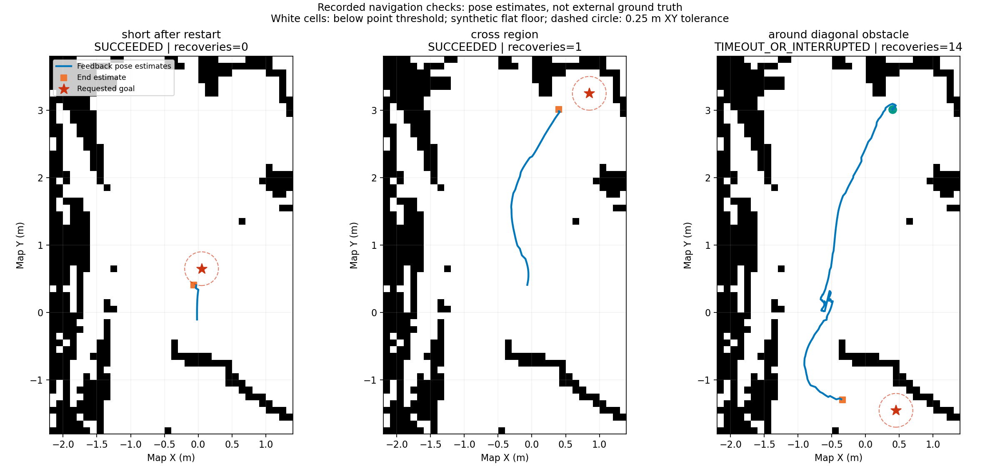
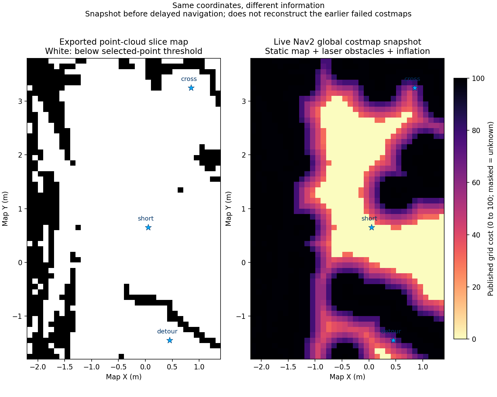

# 第四周练习场景：升级后的验证记录

## 本轮范围

用户完成4个tf2相关包从0.25.23升级至0.25.24，助手核对实际安装版本，重新启动相同的scene_learning地图、世界、出生位置和非组合节点配置。未修改障碍物、导航容差、规划器、控制器或AMCL参数来换取成功。

场景仍是0.1米栅格、393个1米高碰撞体和人工平地。点云切片未证明白格有真实地面支撑；本轮不证明真实场景可通行，也不构成真实机器人定位精度评估。

## 第一轮实测

证据：[原始结果](validation/automatic_v0_20261029_140642/results.json)、[状态表](validation/automatic_v0_20261029_140642/SUMMARY.md)、[实际配置](validation/automatic_v0_20261029_140642/runtime_config.json)。

| 测试 | 请求目标XY(m) | Action结果 | 最大反馈恢复次数 | Action墙钟耗时(s) | 结束后定位估计距请求目标(m) |
|---|---|---|---:|---:|---:|
| 短程 | (0.05,0.65) | SUCCEEDED | 0 | 5.83 | 0.267 |
| 跨区域 | (0.85,3.25) | SUCCEEDED | 1 | 15.85 | 0.510 |
| 绕行斜向障碍 | (0.45,-1.45) | 达到120秒测试时限，已取消 | 14 | 121.95（含取消开销） | 0.805 |

最后一行是测试方设置时限后取消，不是Nav2自行返回ABORTED，也不能单凭它证明路线永久不可达。取消服务接受了对应目标的UUID，记录见同目录cancellation.txt。第一、二次目标前的短时独立TF查询未取得数据，保留为null，没有补造起点；后续将只读查询窗口从4秒延长至8秒。

蓝线为action反馈中的定位估计，橙色方块为事后TF查询位置，红星为请求目标；它们不是外部真值轨迹。图中虚线圆仅标出0.25米位置容差的尺度，不保证Action成功时的事后估计始终在圈内。

本轮初始化后的已保存控制器日志中，未再出现“Unable to transform robot pose”或“Controller patience exceeded”，出现7次“Failed to make progress”；规划器出现5次规划失败。跨区域的一次恢复伴随follow_path请求确认超时和局部代价地图清理。统计起点取首次发送目标时刻，避免把提供初始位姿前正常等待map变换的日志混入运行故障。原始日志和计数表都保留。

## 正常退出检查

第一轮后向启动程序发送一次SIGINT。约10.24秒后，跟踪的启动程序和所有子进程均退出；没有额外发送SIGTERM或SIGKILL。见[退出检查](validation/automatic_v0_20261029_140642/shutdown_check.json)。这支持本次退出行为已改善，但不是所有场景下退出都正常的保证。

## 等待后复测

第一次自动恢复仅确认AMCL处于active并发送一次初始位姿，就开始计时；随后发现AMCL仍持续要求初始位姿。该轮不满足“完成定位后静置”的前提，已标记无效并中止，未发送导航目标，见[无效轮次记录](validation/delayed_v0_20261029_141201/wait_context.json)。

自动初始化现改为重复发送3次相同已知初值、延长发布节点存活时间，并要求map到机器人TF可读及4个相关生命周期节点均为active，才开始计时。尚未确定此前初值未生效的唯一原因；不能只凭命令退出码判断接收方已经处理。

有效轮次实际静置300.009秒，前后跟踪的Gazebo、AMCL、控制器、导航器PID及进程启动标记一致。随后发送同一个短目标(0.05,0.65)，Action返回SUCCEEDED，恢复次数0，Action墙钟耗时4.73秒。没有在等待期间重启节点或修改导航参数。

证据：[等待前提与计时](validation/delayed_v0_20261029_141555/wait_context.json)、[等待后目标结果](validation/automatic_v0_20261029_142126/results.json)。此次开始前和结束后的TF查询均取得数据，事后定位估计距请求目标约0.300米，仍需与“Action成功”的判据分开解释。

此次被动记录到的首条规划路径有14个路径点，终点恰为(0.05,0.65)，见[路径摘要](validation/delayed_v0_20261029_141555/first_path_summary.json)。它只属于这一轮短目标，不能用来解释上一轮跨区域目标的终点。

本轮支持“升级后完成初始化的同一组节点，在5分钟静置后仍能执行该短目标”；尚未覆盖此前更长等待时长、更多重复轮次和其他场景，不能据此认定所有TF异常已彻底解决。

## 下一课：Action成功、目标容差与代价地图

当前goal checker的位置容差为0.25米且stateful=true。跨区域Action成功后，独立查询的定位估计距原请求点0.51米，因此不能把它直接记作“在原目标0.25米内停稳”。还需要记录规划路径终点、目标检查时刻与定位变化。

[NavFn 1.1.20源码](https://github.com/ros-navigation/navigation2/blob/1.1.20/nav2_navfn_planner/src/navfn_planner.cpp)显示，当原目标不可达时，规划器可在tolerance范围内寻找附近可达终点。[SimpleGoalChecker源码](https://github.com/ros-navigation/navigation2/blob/1.1.20/nav2_controller/plugins/simple_goal_checker.cpp)显示，stateful模式在XY条件满足后可以转入只检查朝向。这些是需要检验的机制，尚未证明哪一个解释了本轮0.51米差距；第一轮没有记录规划路径终点，不能事后补造。

实际全局代价地图启用了静态地图、激光障碍层和膨胀层，robot_radius=0.22米，inflation_radius=0.55米。膨胀半径描述代价影响范围，不等于整个范围都是禁止通行区。二维图上某一格为白色，也不能单独证明机器人能通过或正确停靠。下一步由学生在讲解下查看这些参数和目标附近的代价，再决定如何设计可验证的路线。

右图来自等待后目标发送前的一帧实际全局代价地图。short、cross、detour三个目标所在格的发布代价值分别为0、65、65；代价65本身不表示该格一定不可通行，也不能单凭单格判断完整机器人能否停靠。这不是第一轮失败时的代价地图，不能当作旧故障的直接重建。初次命令行导出默认截断了数组，已另存标为truncated；本图使用--full-length重新导出并核对2016格的完整数据。

当前规划器GridBased.tolerance实测为0.5米，位置检查容差为0.25米。两者作用于不同步骤，后续由学生在窗口2读取并对照解释，尚未自动调整这些参数。

## 后续教学：学生亲手选取低代价区目标

学生已在RViz中叠加全局代价地图、将Color Scheme改为costmap，并使用Nav2 Goal工具点击位置、拖动到达朝向。用户确认机器人移动，截图显示Feedback=reached；导航器和控制器日志也确认本次成功。

捕获的首条路径终点约(-0.493744,1.596877)米，与导航器日志中保留两位小数的请求坐标(-0.49,1.60)一致。事后定位估计距该路径终点约0.232米。本轮由学生发送目标，助手仅被动记录，详见[手动目标记录](validation/manual_goal_20261029_143125/README.md)。本次低代价区目标成功不替代前述绕障未通过的记录。

## 后续教学：测量窄缝与全局规划检查

学生使用RViz Measure工具测得一处下边缘缝隙约0.360397米。相对当前圆形近似直径0.44米少约0.080米，按此模型不应将该局部间隙作为可行通道。测量线略斜，不能当作严格垂直的最窄宽度；本例已小于模型直径，不影响筛除该窄缝的判断。尚未证明这处缝隙与此前绕障超时的路径有关。

助手随后调用/compute_path_to_pose检查旧目标(0.45,-1.45)，use_start=false，使用当前估计位姿和当前代价地图。规划Action返回SUCCEEDED，71个路径点，折线长度约4.174米，终点恰为请求目标。此时起点约(-0.40,1.40)，不同于此前超时测试的起点，代价地图也已变化，故不能据此重写旧测试结论。没有向/navigate_to_pose发送行驶目标。

该结果用于下一课区分“全局规划能找到路线”和“控制器能实际沿路线走完”。[数据与测量截图](validation/measured_gap_20261029_144428/summary.json)、[当前计算路径图](validation/measured_gap_20261029_144428/computed_path.png)。

## 尚待完成的工作

- 8份候选仅完成静态几何核对，尚未实测导航或认定哪份高度段最合理。
- 当前GridBased.use_astar仍为False，未开始第五周A*与巡检路线工作。
- 本轮无完整巡检视频、动态障碍验证、真实机器人验证或长时间稳定性保证。

## 绕障执行复测：本次成功

用户反馈尚未移动且希望减少额度消耗后，助手直接发送旧目标(0.45,-1.45)的导航任务，保持原导航参数。此次Action返回SUCCEEDED，最大反馈恢复次数3，Action墙钟耗时约40.89秒；原始结果和估计轨迹保存在validation/automatic_v0_20261029_144742。本次从学生手动导航后的当前位置出发，起点及代价地图不同于先前超时轮次，旧失败记录保留。本次成功仅证明当前条件下该路线完成，尚未证明无恢复或长期稳定。

## 关闭后恢复与交付整理

用户恢复学习后，已检查旧仿真和导航进程退出，重新启动同一个Hilti练习场景。自动重复提供已知初值，核实map到机器人TF及生命周期节点就绪，再以wait-seconds=0执行短目标，返回SUCCEEDED，恢复0次，Action墙钟耗时8.34秒。证据：validation/automatic_v0_20261029_164209。本次不是额外一次5分钟静置测试。

补齐之前临时执行的地图导出步骤为export_nav2_map.py，并在独立工作目录验证重导出YAML语义和PGM像素均与原件一致。进一步核对393个地图占据格、393个碰撞体和393个visual对应，检查记录见validation/delivery_audit_20261029.json。场景本身、切片高度和导航参数均未改动。

复现入口、输入来源、实验结果及适用边界整理在[第四周交付说明](第四周交付说明.md)。静态候选仍未实测或认定更优，不将准备候选的数量计作导航实验数量。
