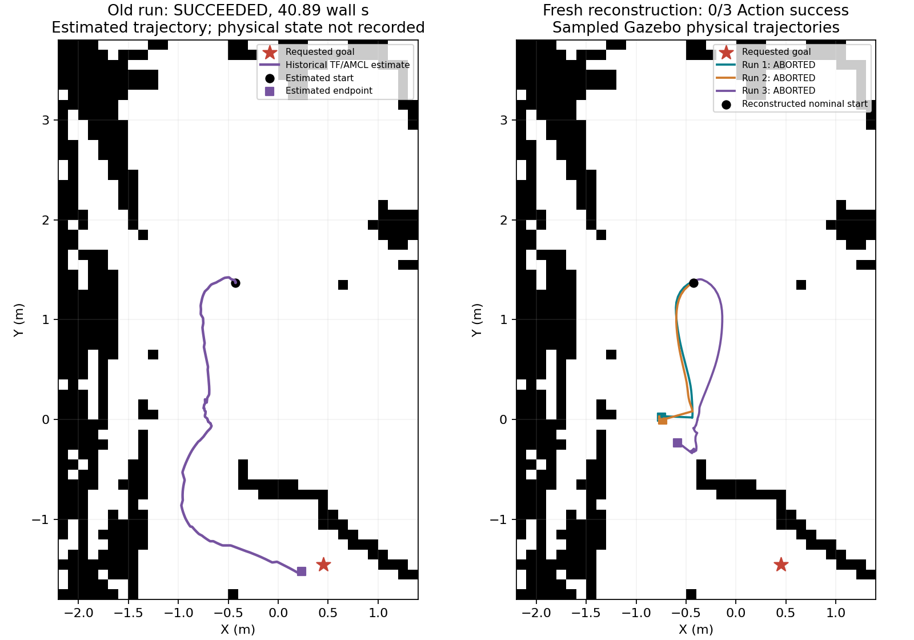

# 旧成功起点的三轮近似复现

## 为什么做这次复测

旧表中的绕障成功确实存在：Action返回SUCCEEDED，墙钟40.89秒，3次恢复。近期默认启动点的6轮超时并非该成功起点的重复试验，不能据此否定旧成功记录。

## 本次条件

- 参照旧TF日志，将起点重建为(-0.427,1.370)米，朝向94.02°。
- 目标仍为(0.45,-1.45)米，朝向0°。地图、world原几何与近期默认启动点批次哈希一致；Nav2参数文件逐字节一致。
- 每轮新启动Gazebo和Nav2，已知初值初始化，准备好激光、时钟、TF后发送目标；墙钟上限120秒。
- 旧起点是AMCL/TF估计，旧仿真真实位置、粒子分布和代价地图历史未保存。因此本次是近似重建，不能称为全部状态相同的精确重放。
- 新试验以Gazebo状态测量停稳后终点；旧记录只有估计位置，两个来源分别说明。

## 逐轮结果

|记录|Action状态|墙钟(s)|恢复次数|仿真真实终点距目标(m)|定位估计终点距目标(m)|
|---|---|---:|---:|---:|---:|
|旧成功记录|SUCCEEDED|40.89|3|未测|0.227|
|本次第1轮|ABORTED|30.563|15|1.899|2.235|
|本次第2轮|ABORTED|30.513|15|1.867|2.187|
|本次第3轮|ABORTED|118.540|19|1.598|1.887|

本次Action成功：0/3；停稳后仿真位置距离≤0.25米：0/3。

ABORTED表示Nav2自行返回任务失败；TIMEOUT_CANCELED表示达到本次120秒墙钟上限后由试验脚本取消，两者分别记录。

## 可得出的结论

本次3轮未复现旧成功。旧成功记录仍保留；近似重建未成功不能证明旧结果无效，也不能把它描述为已稳定复现。需要进一步区分真实起点、定位状态和执行过程的影响。

## 失败日志与排查线索

本次三轮日志均出现规划器无法生成有效路径的提示；第三轮还反复出现Failed to make progress。它们说明失败发生在规划/执行过程中，但尚不足以单独确认根因。
停稳后AMCL/TF估计与Gazebo实际位置的距离为0.445米、0.397米、0.474米。该差异值得进一步检查，不能仅凭超时或失败就断定障碍间距不够。

## 证据

- protocol.json保存起终点、条件、哈希和重建限制；installed_nav2_params.yaml保存参数文件。
- 每轮result.json与launch.log保存状态、位姿、轨迹和程序日志；results.json合并全部三轮。
- 历史记录目录：/mnt/c/Users/Administrator/Documents/Codex/2026-10-26/https-github-com-xiaoyinne-1-git-2/outputs/week4_learning/validation/automatic_v0_20261029_144742

没有测量真实硬件精度或碰撞接触事件；不将恢复次数解释为碰撞次数。