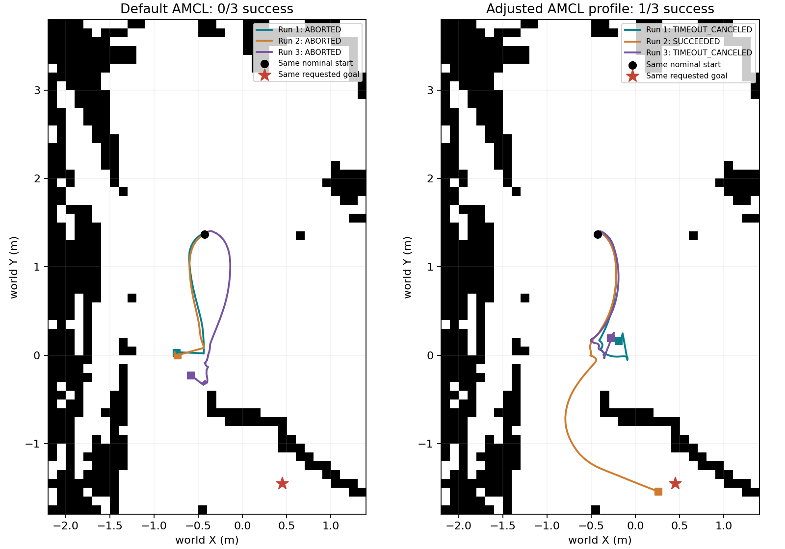
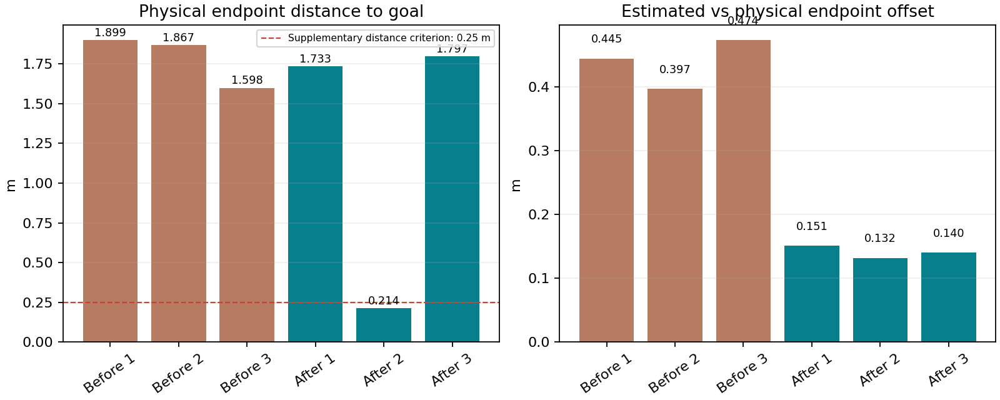

# 绕障定位参数调整与重复验证

## 本次做了什么

在旧成功起点的近似重建任务中，保持地图、障碍几何、起终点、控制器、规划器、初始位姿协方差和120秒上限一致，只调整一组AMCL参数。先做1轮探索，再冻结参数做3轮独立确认。

## 为什么先检查定位

静止审计中，按仿真真实位姿和雷达安装位置对原始障碍几何进行射线计算，256条有限有效激光距离的RMSE约0.0105米，全部在0.05米以内。它支持该静止位置处激光与障碍几何一致，不能概括所有位置。
同一时刻里程计位置与Gazebo位置相符，AMCL/TF位置约偏0.106米。默认参数绕障结束时估计与仿真位置约差0.40～0.47米，因此先尝试调整激光匹配。

## 参数与通俗解释

|参数|调整前|调整后|含义|
|---|---:|---:|---|
|max_beams|60|180|使用更多激光束参与匹配|
|sigma_hit|0.2|0.1|减小匹配模型中命中距离的宽度|
|update_min_a|0.2|0.05|转动更小角度后允许更新定位|
|update_min_d|0.25|0.05|移动更短距离后允许更新定位|
|z_hit|0.5|0.95|提高命中模型权重|
|z_rand|0.5|0.05|降低随机测量模型权重|

地图分辨率仍为0.1米，规划容差仍为0.5米，到达位置容差仍为0.25米，朝向容差仍为0.25弧度。该组参数按当前简化场景探索，不是所有真实环境的通用推荐。

## 全部导航试验

|阶段|轮次|Action状态|墙钟(s)|恢复|实际终点距目标(m)|定位估计与实际终点差(m)|朝向误差(°)|
|---|---:|---|---:|---:|---:|---:|---:|
|调整前|1|ABORTED|30.56|15|1.899|0.445|95.1|
|调整前|2|ABORTED|30.51|15|1.867|0.397|112.5|
|调整前|3|ABORTED|118.54|19|1.598|0.474|32.9|
|探索轮|1|SUCCEEDED|39.65|3|0.216|0.116|14.4|
|调整后确认|1|TIMEOUT_CANCELED|120.06|10|1.733|0.151|109.0|
|调整后确认|2|SUCCEEDED|68.01|5|0.214|0.132|14.4|
|调整后确认|3|TIMEOUT_CANCELED|120.06|10|1.797|0.140|99.0|

探索轮不计入后续3轮确认的成功率。启动检查未通过且未发送导航目标的记录独立保留，不计入导航任务结果。

## 怎样讲这个结果

调整前，当前重建起点下3轮Action成功0/3。调整后独立确认成功1/3，停稳后位置距离≤0.25米1/3，同时满足Action、位置和朝向检查0/3。
这是当前场景下的一组初步对照。一次修改了6个AMCL参数，不能把变化归功于某一个参数；每组仅3轮，也不能据此宣称长期稳定或优于其他导航算法。
旧40.89秒成功记录保留。其起点来自当时的定位估计，本次重建无法恢复旧粒子分布或代价地图历史。

## 所有其他结果如何保留

- 默认启动点6轮超时仍保留在原目录，不与本次历史估计起点任务合并。
- 单柱绕行2/3成功属于另一条任务，保留为补充案例，不冒充本次绕障路线。
- 调整前证据：/mnt/c/Users/Administrator/Documents/Codex/2026-10-26/https-github-com-xiaoyinne-1-git-2/outputs/week4_learning/validation/repeated_confirmation_20261030_212801
- 探索轮证据：/mnt/c/Users/Administrator/Documents/Codex/2026-10-26/https-github-com-xiaoyinne-1-git-2/outputs/week4_learning/validation/repeated_tuning_20261030_225835
- 调整后确认：/mnt/c/Users/Administrator/Documents/Codex/2026-10-26/https-github-com-xiaoyinne-1-git-2/outputs/week4_learning/validation/repeated_confirmation_20261030_230038
- 静止传感器审计：/mnt/c/Users/Administrator/Documents/Codex/2026-10-26/https-github-com-xiaoyinne-1-git-2/outputs/week4_learning/validation/diagnostic_20261030_214829
- 初次参数探索启动未通过：/mnt/c/Users/Administrator/Documents/Codex/2026-10-26/https-github-com-xiaoyinne-1-git-2/outputs/week4_learning/validation/repeated_tuning_20261030_215103

来源：[Nav2 Humble激光似然场实现](https://raw.githubusercontent.com/ros-navigation/navigation2/humble/nav2_amcl/src/sensors/laser/likelihood_field_model.cpp)。
本次没有测量碰撞接触事件，不把恢复次数作为碰撞次数。