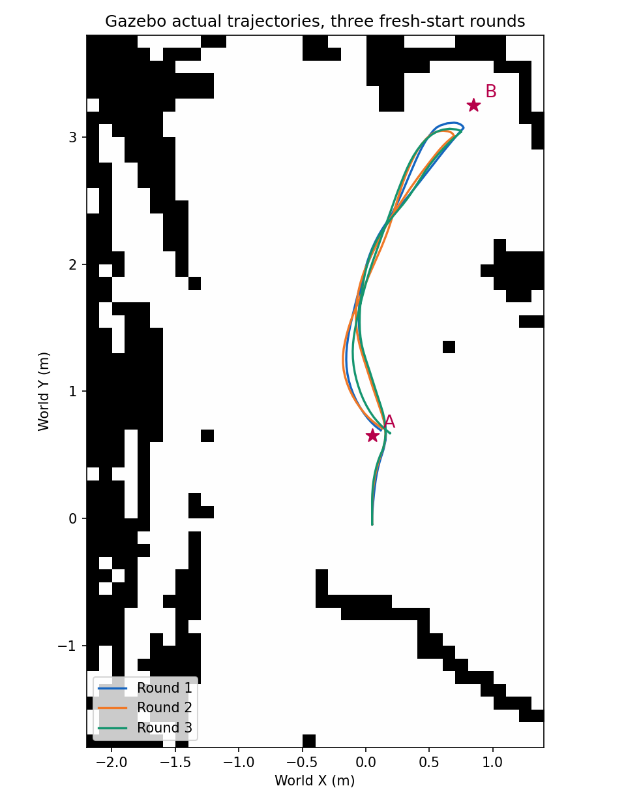

# 第五周：自动巡检与停车实测

学生三：尹安伟。演示日期 2026-11-03，统一三轮实测日期 2026-11-04，归档日期 2026-11-05。

本周沿用第四周的 Hilti 局部地图与 Gazebo 场地，把单点导航串成 A、B、A 顺序任务，并增加停稳后的外部位姿测量。使用 AMCL 定位、NavFn 的 A* 模式规划、DWB 控制。

## 从哪里开始看

| 材料 | 内容 |
|---|---|
| [大白话讲解](docs/第五周讲解_大白话与实际例子版.md) | 用实际例子理解定位、规划、控制和巡检脚本 |
| [详细讲解](docs/第五周讲解_导航闭环与巡检路线.md) | 学习过程、代码及知识点；其中历史数据不并入三轮统计 |
| [当前汇报讲稿](docs/第五周汇报_逐页讲解稿_流程页优化版.md) | 整合流程和正式实测结果，含逐页讲法；PPT暂不上传 |
| [九次到点的位姿与误差](docs/第五周_九次到点位姿与误差明细.md) | 每轮每段的规划终点、估计/实际位姿、位置和朝向误差 |
| [实验解释与结果](experiments/patrol_20261104/补充实验讲解与结果.md) | 实验条件、判定标准和限制 |
| [复现步骤](REPRODUCE.md) | 本地启动、自动实测、重新汇总数据 |
| [带标记演示视频](media/第五周_A-B-A巡检演示_带标记_20261103_2031.mp4) | 约43秒，A/B目标点及绿色规划路径；GitHub可能需要下载播放 |

## 正式结果

三轮均重新启动仿真，固定出生位置与 AMCL 初值，执行出生点至 A、A 至 B、B 返回 A；两个地点、每轮三个任务。三轮总计九次到点，目标朝向均为90°。

| 指标 | 结果 |
|---|---:|
| 完整巡检路线 | 3/3 |
| 导航 Action 返回成功 | 9/9 |
| 实际位置误差≤0.25米 | 8/9 |
| 实际朝向误差≤0.25弧度（约14.3°） | 6/9 |
| 位置、朝向同时达标且停稳 | 5/9 |
| 每轮墙钟时间（含测量等待） | 47.50、47.48、47.83秒 |

Action成功和外部测量是否达标分别记录。第二轮B位置误差约0.288米，尽管导航任务返回成功，位置检查仍不达标。NavFn允许在目标附近搜索终点，B的最后规划终点与原目标不同；系统定位估计也有偏差，现有数据不能唯一分解全部误差来源。

演示视频记录的一轮为38.64秒，其起点、图形窗口和测量等待与正式实验不同，不直接比较耗时。

## 文件组织

- `code/`：可运行代码、参数、RViz配置、地图与世界；基于脚本所在目录寻址。
- `experiments/patrol_20261104/`：三轮原始JSON、完整启动日志、输入快照、CSV和汇总；原始证据保持原字节。
- `history/`：早期学习脚本与演示日志，保留已发生的等待/通信问题。
- `docs/`：保留当前讲稿与两份知识讲解，旧版PPT讲稿未重复收录。
- `media/`：保留最终带标记视频；较早无标记视频未重复收录。
- `ARCHIVE_MANIFEST.json`：本次归档所有文件的字节数与SHA256（不含清单本身）。
- `VALIDATION.json`：归档核验结果。

本次未上传任何第五周PPT，也没有改动仓库里前几周已经存在的PPT。

## 结论范围

这是已知初值、小型简化场景中的顺序到点仿真。未固定随机种子，未记录碰撞接触；没有完成真实硬件验证、长期稳定性验证、设备检查动作或三维跨session重定位接入。通信异常的底层原因尚未最终定位，等待上限用于避免脚本无限等待。
