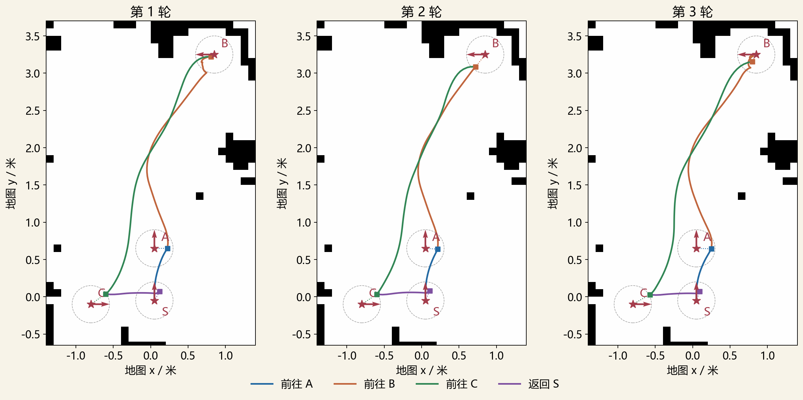

# 第五周：基于自建地图的导航闭环与多点巡检

学生三：尹安伟。最终三轮实测日期为 2026-11-11，归档更新日期为 2026-11-12。

沿用第四周生成的 Hilti 局部地图与 Gazebo 场地，使用 AMCL 定位、NavFn 的 A* 搜索模式和 DWB 控制。Python 脚本依次发送 A、B、C、S 四个目标位姿，从基地 S 出发巡检并返回基地。每段任务结束后确认停稳、记录实际位姿与误差，再根据执行结果决定是否继续。

## 阅读入口

| 材料 | 内容 |
| --- | --- |
| [详细学习与汇报手册](docs/第五周学习与汇报手册.md) | 初学者讲解、实际例子、代码流程、八页汇报稿和答辩问答 |
| [十二次到点的位姿与误差](docs/第五周_十二次到点位姿与误差明细.md) | 原始目标、规划终点、实际停车位姿及逐次误差 |
| [运行与复现](REPRODUCE.md) | 图形演示、三轮独立测量和结果重算 |
| [最终实验与原始证据](experiments/patrol_20261111_multiyaw/) | 三轮正式结果、单独预运行、日志、输入快照、哈希和轨迹图 |
| [归档核验](VALIDATION.json) | 原始误差重算、输入哈希、代码语法和文件范围 |

第五周 PPT 按要求仅保留在本地，不在本目录上传。手册中的讲稿对应本地八页版本。

## 任务与固定条件

| 点位 | 位置 (x, y) / 米 | 目标朝向 | 用途 |
| --- | --- | --- | --- |
| S | (0.05, -0.05) | 90° | 已知出生位姿，也是最后返回的目标 |
| A | (0.05, 0.65) | 90° | 第一巡检点 |
| B | (0.85, 3.25) | 180° | 第二巡检点 |
| C | (-0.80, -0.10) | 0° | 第三巡检点 |

每轮重新启动仿真，使用相同地图、参数、出生位姿、AMCL 初值和目标清单。三轮共十二次导航，目标朝向固定而非每轮随机。地图为 `code/scene_learning/map.pgm` 与 `map.yaml`，场地为同目录 `hilti_cells.world`。全局与局部代价地图在运行时更新。

当前到点判定配置为位置容差 0.12 米、朝向容差 0.10 弧度，NavFn 附近终点搜索容差为 0.15 米。实际效果另按原始目标评价：位置误差不超过 0.25 米、最短朝向误差不超过 0.25 弧度（约 14.3°），且确认停稳。

## 最终三轮结果

| 指标 | 结果 |
| --- | ---: |
| 完整巡检路线 | 3/3 |
| 导航 Action 返回成功 | 12/12 |
| 实际位置达标 | 11/12 |
| 实际朝向达标 | 12/12 |
| 位置、朝向同时达标且停稳 | 11/12 |
| 平均位置误差 | 0.171 米 |
| 平均朝向误差 | 6.00° |

| 任务段 | Action 成功 | 位置误差 / 米：均值 [最小, 最大] | 朝向误差 / 度：均值 [最小, 最大] | 联合达标 | 导航动作均时 / 秒 |
| --- | --- | --- | --- | --- | --- |
| S 到 A | 3/3 | 0.179 [0.164, 0.200] | 6.75 [5.40, 7.63] | 3/3 | 7.37 |
| A 到 B | 3/3 | 0.122 [0.053, 0.207] | 4.62 [1.19, 10.91] | 3/3 | 28.02 |
| B 到 C | 3/3 | 0.246 [0.239, 0.261] | 5.51 [5.24, 5.82] | 2/3 | 21.42 |
| C 返回 S | 3/3 | 0.137 [0.127, 0.143] | 7.13 [6.68, 7.76] | 3/3 | 10.83 |

第三轮 C 点实际位置误差约 0.261 米，超过 0.25 米标准，保留为未达标记录。导航 Action 成功与外部精度达标分别统计。当前程序的继续条件是 Action 成功且确认停稳，外部误差超出会记录，但不会因此自动重试或阻断下一段。

三轮总墙钟时间分别为 91.91、72.44、87.51 秒，包含通信准备、测量及停稳等待，与表内单段导航动作耗时的计时范围不同。

## 文件组织与历史版本

- `code/`：最终 S-A-B-C-S 多朝向版本的默认运行入口。
- `experiments/patrol_20261111_multiyaw/`：最终三轮正式证据与独立预运行，完整保留未达标记录。
- `experiments/patrol_20261104/`：早期 A-B-A、全部目标朝向 90° 的历史三轮证据，不与当前结果合并。
- `history/code_20261104/`：更新默认代码前保存的早期 A-B-A 代码，对应旧实验。
- `history/` 与 `media/`：早期学习记录和 A-B-A 演示视频，视频不代表当前四段巡检。
- `docs/第五周_九次到点位姿与误差明细.md`：旧实验明细，仅作历史参考。
- `ARCHIVE_MANIFEST.json`：当前第五周目录文件的字节数与 SHA256，不包含清单本身。

旧版重复讲解已按本地整理要求移除，由当前详细手册替代，原始实验数据继续保留。

## 结论范围

这是已知初始位姿、小型简化场地中的仿真实验。AMCL、NavFn、DWB 使用现有 Nav2 模块，本周自行编写任务组织与测量程序。没有做 Dijkstra 与 A* 的同条件性能对照，也没有完成自动设备检查、充电对接、实车或长期可靠性验证。三轮未固定随机种子，未采集碰撞接触数据。不同历史配置、路线或朝向的结果不用于直接证明单个算法优劣。
