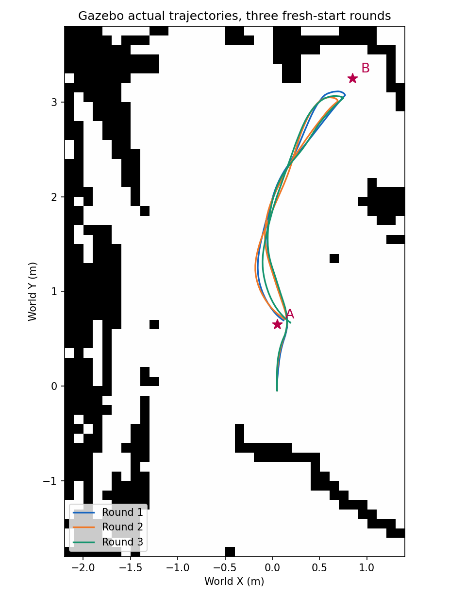

# 第五周补充实验：三轮独立启动巡检与停车误差

实验日期：2026-11-04。该组是新增的无图形窗口测量实验，原演示视频及其 38.64 秒记录继续作为此前的演示证据。

## 这次补充了什么

原来脚本主要回答“小车能否依次完成任务”。现在增加自动测量，让每个任务结束后等待至少两个仿真秒，确认机器人速度足够小，再保存实际停车位置、朝向、估计位置、规划路线和恢复反馈。三轮分别重启完整仿真，每轮执行出生点至 A、A 至 B、B 至 A。

## 实验条件

- 同一份 Hilti 局部栅格和障碍世界，A=(0.05,0.65)，B=(0.85,3.25)，目标朝向均为 +Y。
- 每轮出生位姿固定为 (0.05,-0.05,π/2)，使用相同 AMCL 初值和协方差。随机种子没有固定。
- 导航参数固定为当前第五周参数，运行时逐轮核对 A* 开启、DWB 控制器及到达容差。
- 无 Gazebo 图形客户端和 RViz。使用 ROS 域 35、独立 Gazebo master 11355，程序只清理自己启动的进程组。
- 原 world 只增加状态测量插件，提供实际状态查询；移除该插件后，XML 结构与源 world 相同，障碍和地面没有更改。
- 每段发送前处理约 2 秒通信事件。动作等待最多 120 秒，结束后至少等待两个仿真秒，并检查平移速度 <0.01m/s、角速度 <0.03rad/s。
- 实际姿态来自 Gazebo 世界坐标中的 turtlebot3_waffle::base_footprint；估计姿态来自 map 到 base_footprint 的 TF。本场景地图与世界坐标按已有生成关系对应。

## 结果一：任务成功与实际检查标准分别统计

三轮完整路线完成 **3/3**，预定的九次导航 Action 返回成功 **9/9**。九次均成功读取实际状态并验证停稳。

实际位置距离≤0.25m：**8/9**；实际朝向误差≤0.25rad：**6/9**；两项同时满足且停稳：**5/9**。这些是我们用 Gazebo 实际状态另行计算的检查结果。

| 轮次 | Action 成功 | 实际位置达标 | 位置与朝向同时达标 | 整轮墙钟耗时（秒） |
|---|---:|---:|---:|---:|
| 1 | 3/3 | 3/3 | 2/3 | 47.50 |
| 2 | 3/3 | 2/3 | 1/3 | 47.48 |
| 3 | 3/3 | 3/3 | 2/3 | 47.83 |

整轮时间包含逐段通信准备、动作执行、实际状态查询和停稳等待，初始化预热不计入。新实验的无图形窗口条件与原视频不同，不能把约47秒与原38.64秒当作算法性能对比。

## 结果二：逐点实测

| 轮次 | 目标 | 动作耗时（秒） | 位置误差（米） | 朝向误差（度） | 反馈最大恢复次数 | 两项达标 |
|---|---|---:|---:|---:|---:|---|
| 1 | A1 | 4.25 | 0.144 | 13.66 | 0 | 是 |
| 1 | B | 13.56 | 0.197 | 16.02 | 0 | 否 |
| 1 | A2 | 17.63 | 0.079 | 10.88 | 0 | 是 |
| 2 | A1 | 3.93 | 0.139 | 14.76 | 0 | 否 |
| 2 | B | 13.75 | 0.288 | 13.90 | 0 | 否 |
| 2 | A2 | 17.57 | 0.098 | 11.05 | 0 | 是 |
| 3 | A1 | 4.13 | 0.139 | 14.67 | 0 | 否 |
| 3 | B | 13.94 | 0.231 | 13.45 | 0 | 是 |
| 3 | A2 | 17.51 | 0.142 | 10.99 | 0 | 是 |

A1 表示出生点至 A，A2 表示返回 A。动作耗时从发送请求到结果返回，另行记录的停稳等待和发送前准备不含在这列中。恢复次数取已收到反馈的最大值，不等同于重规划次数，也不表示测量了碰撞事件。

## 结果三：B 点实际采用了附近规划终点

原始 B 坐标为 (0.85,3.25)。程序保存的最后一条全局路径显示：

| 轮次 | 最后规划终点 | 与原始B的距离（米） | 停稳估计与实际位置的距离（米） |
|---|---|---:|---:|
| 1 | (0.55,3.05) | 0.361 | 0.377 |
| 2 | (0.55,3.05) | 0.361 | 0.279 |
| 3 | (0.55,3.15) | 0.316 | 0.280 |

这次有了直接的路径记录：B 点最后发布的规划终点与原目标不同，与当前 NavFn 的0.5米附近终点搜索容差行为一致。同时，估计位置与实际位置也有差异。它们共同说明为什么需要把原目标、规划终点、估计停车位置和实际停车位置分别记录。目前没有把全部偏差唯一归因到某一个因素。

例如第二轮 B 点 Action 成功，而实际停车距原目标约0.288米。因此汇报中应说“任务均完成，同时位置与朝向检查仅5/9通过”，不能把9/9成功写成9/9精确停靠。

## 实际行走轨迹

下图使用 Gazebo 实际位置采样绘制，底图为原始占据栅格。它展示的是本组三轮的实际轨迹，不是 RViz 的当前规划线。



## 怎样理解新增代码

- `measurement_core.py`：沿用第四周已使用的定位等待和状态测量代码，并在每段前清空该段的反馈、轨迹和规划记录。
- `patrol_measured.py`：运行一轮，逐点测量、验证参数、保存JSON；不成功则停止后续点。
- `repeat_patrol.py`：每轮新启仿真，运行测量客户端，保留日志，最后结束自己启动的进程组。
- `measurements.csv`：九次任务的扁平结果表，可直接用于汇报表格。
- `round_01` 至 `round_03/result.json`：完整实际轨迹、反馈、规划路径及终点测量。
- `protocol.json` 和 `inputs/`：实验条件、依赖版本、输入哈希和代码快照。

当前代码没有修改原来的 `patrol.py`，旧演示流程仍可使用。新增入口在 `/home/yaw/nav2_week5/`，后续重新执行三轮：

```bash
source /opt/ros/humble/setup.bash
/usr/bin/python3 -s /home/yaw/nav2_week5/repeat_patrol.py --run --repeats 3
```

新实验自动准备场地与初值、执行测量并关闭自己的仿真，不需要手动开三个窗口。每次结果写进一个新的 validation/patrol_时间 目录。程序完整结果为JSON；本次归档CSV和汇总由这些原始JSON生成。

生成下一组实验的 CSV 与汇总时，将程序打印的结果目录传给汇总工具：

```bash
/usr/bin/python3 -s /home/yaw/nav2_week5/summarize_patrol.py /home/yaw/nav2_week5/validation/实际结果目录
```

归档的 `analysis_tools/summarize_patrol.py` 是同一工具的副本，已使用本组三轮原始 JSON 验证可重建结果表。`inputs/` 保留实际运行时的输入版本。

## 汇报时可以这样解释

“我补充了三轮统一条件的巡检实验。每轮重新启动，固定地图、参数和出生位置，结束后验证停稳并测量实际位姿。九个任务都返回成功，但位置单项满足检查标准的是8个，朝向单项是6个，两项同时满足的是5个。记录还发现B点使用了附近的规划终点，且估计与实际位置存在偏差。因此我把任务状态、规划终点和实际停车误差分开报告。”

## 结论范围

三轮属于同一小场景的小样本验证，随机种子未固定。本次未进行碰撞接触事件统计、真实硬件验证，也未证明长期稳定性。结果没有混入早期手动实验或原视频耗时，没有为了让统计更好而调整参数后替换某轮结果。
